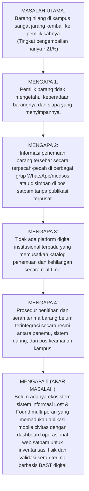
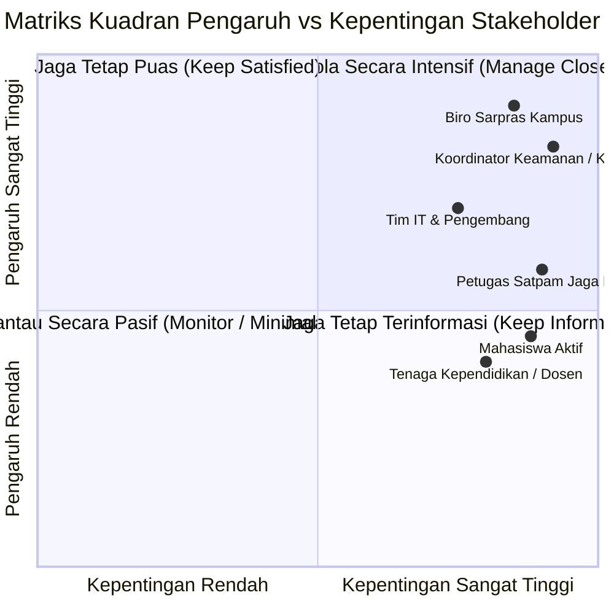
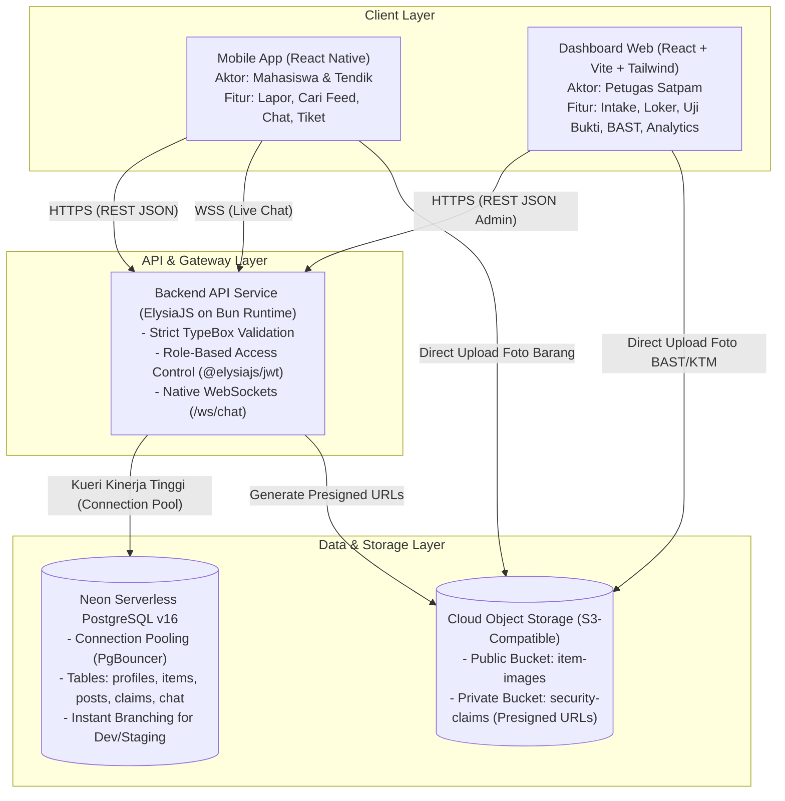
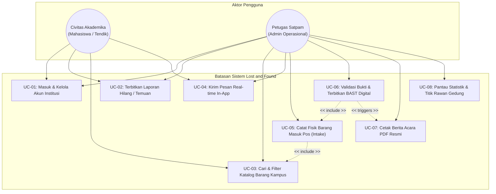
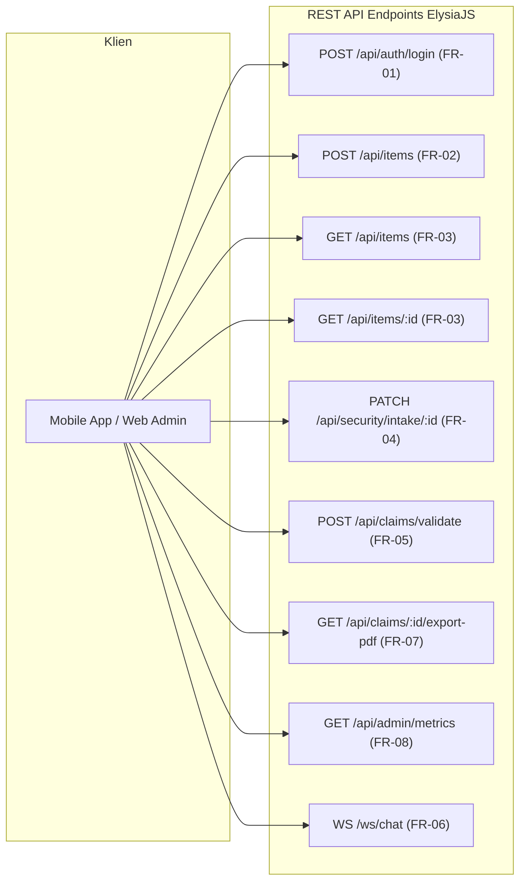

# Laporan Analisis Kebutuhan Sistem Informasi Lost & Found
## Rekayasa Kebutuhan Perangkat Lunak untuk Pengelolaan Barang Hilang dan Temuan di Lingkungan Kampus Terpadu

---

| Dokumen | Laporan Analisis Kebutuhan Perangkat Lunak (System Requirements Analysis) |
| :--- | :--- |
| **Nama Sistem** | **Lost & Found (`lostnfound`)** |
| **Target Lingkungan** | Lingkungan Kampus Terpadu (Fakultas, Gedung Kuliah, Laboratorium, Perpustakaan, Area Parkir) |
| **Penyusun** | Tim Analis Sistem & Rekayasa Perangkat Lunak |
| **Status Dokumen** | *Final Requirements Baseline (Design Phase)* |
| **Target Teknologi** | **Backend**: ElysiaJS (Bun Runtime) <br> **Database**: Neon (Serverless PostgreSQL) <br> **Web Admin**: React + Vite + Tailwind CSS <br> **Mobile App**: React Native |
| **Tanggal Pembaruan** | 2026-11-03 |

---

## Daftar Isi

1. [Bab 1: Latar Belakang Masalah](#1-latar-belakang-masalah)
   - 1.1 [Deskripsi Topik](#11-deskripsi-topik)
   - 1.2 [Bukti Pendukung dan Fakta Lapangan](#12-bukti-pendukung-dan-fakta-lapangan)
2. [Bab 2: Identifikasi Masalah Menggunakan Metode 5 Whys](#2-identifikasi-masalah-menggunakan-metode-5-whys)
3. [Bab 3: Analisis Pemangku Kepentingan (Stakeholders Analysis)](#3-analisis-pemangku-kepentingan-stakeholders-analysis)
   - 3.1 [Tabel Identifikasi Pemangku Kepentingan](#31-tabel-identifikasi-pemangku-kepentingan)
   - 3.2 [Grid Kuadran Pengaruh dan Kepentingan (Power-Interest Grid)](#32-grid-kuadran-pengaruh-dan-kepentingan-power-interest-grid)
4. [Bab 4: Pernyataan Masalah (Problem Statement)](#4-pernyataan-masalah-problem-statement)
5. [Bab 5: Arsitektur dan Karakteristik Sistem](#5-arsitektur-dan-karakteristik-sistem)
   - 5.1 [Arsitektur Solusi Terpilih](#51-arsitektur-solusi-terpilih)
   - 5.2 [Karakteristik Kunci Perangkat Lunak](#52-karakteristik-kunci-perangkat-lunak)
6. [Bab 6: Kebutuhan Pengguna Berdasarkan Stakeholder dan Elisitasi](#6-kebutuhan-pengguna-berdasarkan-stakeholder-dan-elisitasi)
   - 6.1 [Metodologi dan Teknik Elisitasi Kebutuhan](#61-metodologi-dan-teknik-elisitasi-kebutuhan)
   - 6.2 [Daftar Kebutuhan Pengguna per Stakeholder](#62-daftar-kebutuhan-pengguna-per-stakeholder)
7. [Bab 7: Kebutuhan Fungsional (Functional Requirements)](#7-kebutuhan-fungsional-functional-requirements)
8. [Bab 8: Kebutuhan Non-Fungsional (Non-Functional Requirements Berbasis ISO/IEC 25010)](#8-kebutuhan-non-fungsional-non-functional-requirements-berbasis-isoiec-25010)
9. [Bab 9: Ruang Lingkup Sistem (Scope, Assumptions, and Constraints)](#9-ruang-lingkup-sistem-scope-assumptions-and-constraints)
   - 9.1 [In-Scope (Batasan Ruang Lingkup Masuk)](#91-in-scope-batasan-ruang-lingkup-masuk)
   - 9.2 [Out-of-Scope (Batasan di Luar Lingkup)](#92-out-of-scope-batasan-di-luar-lingkup)
   - 9.3 [Asumsi Operasional](#93-asumsi-operasional)
   - 9.4 [Batasan Desain & Teknologi (Constraints)](#94-batasan-desain--teknologi-constraints)
10. [Bab 10: User Story dan Spesifikasi Use Case](#10-user-story-dan-spesifikasi-use-case)
    - 10.1 [Daftar User Story Utama](#101-daftar-user-story-utama)
    - 10.2 [Diagram Visual Use Case Sistem](#102-diagram-visual-use-case-sistem)
    - 10.3 [Spesifikasi Rinci Use Case Pilihan](#103-spesifikasi-rinci-use-case-pilihan)
11. [Bab 11: Draf Kontrak Endpoint REST API](#11-draf-kontrak-endpoint-rest-api)
12. [Bab 12: Kriteria Keberhasilan SMART dan Matriks Keterlacakan](#12-kriteria-keberhasilan-smart-dan-matriks-keterlacakan)
    - 12.1 [Kriteria Keberhasilan Berbasis SMART](#121-kriteria-keberhasilan-berbasis-smart)
    - 12.2 [Matriks Keterlacakan Kebutuhan (Requirements Traceability Matrix)](#122-matriks-keterlacakan-kebutuhan-requirements-traceability-matrix)
13. [Bab 13: Daftar Pustaka dan Lampiran](#13-daftar-pustaka-dan-lampiran)
    - 13.1 [Daftar Pustaka](#131-daftar-pustaka)
    - 13.2 [Lampiran 1: Notulen Wawancara & Observasi Pos Satpam](#132-lampiran-1-notulen-wawancara--observasi-pos-satpam)
    - 13.3 [Lampiran 2: Rekapitulasi Hasil Survei Elisitasi Civitas Akademika](#133-lampiran-2-rekapitulasi-hasil-survei-elisitasi-civitas-akademika)

---

## 1. Latar Belakang Masalah

### 1.1 Deskripsi Topik
Aktivitas harian di lingkungan kampus melibatkan puluhan ribu civitas akademika—terdiri atas mahasiswa, tenaga kependidikan (tendik), dosen, hingga staf pendukung—yang berpindah dari satu gedung ke gedung lainnya (ruang kuliah bersama, laboratorium sains/komputer, perpustakaan utama, kantin, gedung rektorat, fasilitas olahraga, hingga kantong parkir). Tingginya tingkat mobilitas ini berbanding lurus dengan tingginya frekuensi insiden barang hilang (*lost*) atau tertinggal (*misplaced*), seperti dompet, Kartu Tanda Mahasiswa (KTM), gawai elektronik (ponsel pintar, tablet, pengisi daya, laptop), kunci kendaraan bermotor, botol minum (*tumbler*), hingga dokumen akademik berharga.

Secara konvensional, penanganan barang hilang di perguruan tinggi masih sangat terfragmentasi. Informasi kehilangan dan penemuan umumnya disebarkan secara sporadis melalui grup percakapan temporer (WhatsApp Group, Telegram), fitur siaran media sosial (*Instagram Story / Menfess Twitter*), atau pesan lisan antar individu. Kondisi ini menimbulkan berbagai kerugian sistemik: informasi cepat tertimbun percakapan lain, keterbatasan jangkauan pesan ke korban yang sebenarnya, tidak adanya titik penyimpanan fisik yang terstandarisasi, serta tingginya risiko klaim palsu (*false claim / fraud*) akibat ketiadaan mekanisme pengujian bukti kepemilikan dan identitas resmi.

Di sisi lain, unit Satuan Pengamanan (Satpam) kampus di pos-pos penjagaan sering menerima titipan barang temuan dari mahasiswa yang berniat baik. Namun, tanpa adanya sistem inventarisasi digital, pencatatan fisik barang di pos jaga masih dilakukan pada buku ekspedisi manual kertas yang rentan rusak, tercecer, dan tidak terhubung ke civitas akademika secara luas. Akibatnya, barang temuan menumpuk berbulan-bulan di laci pos satpam tanpa pernah diambil oleh pemilik sahnya.

### 1.2 Bukti Pendukung dan Fakta Lapangan
Berdasarkan hasil studi pendahuluan, observasi pos keamanan, dan survei elisitasi kebutuhan terhadap 120 responden di lingkungan kampus (lihat [Lampiran 2](#133-lampiran-2-rekapitulasi-hasil-survei-elisitasi-civitas-akademika)), ditemukan data empiris sebagai berikut:

```
[Distribusi Saluran Pelaporan Barang Hilang Saat Ini]
┌──────────────────────────────────────────────┬─────────────┐
│ Saluran Pelaporan                            │ Persentase  │
├──────────────────────────────────────────────┼─────────────┤
│ WhatsApp Group / Media Sosial (Instagram/X)  │    72.5%    │
│ Datang Langsung ke Pos Satpam Kampus         │    14.2%    │
│ Bertanya ke Bagian Tata Usaha Gedung         │     8.3%    │
│ Pasrah / Tidak Melapor Sama Sekali           │     5.0%    │
└──────────────────────────────────────────────┴─────────────┘
```

1. **Rendahnya Tingkat Pengembalian (*Recovery Rate*)**: Dari responden yang pernah kehilangan barang berharga di kampus dalam 1 tahun terakhir, hanya **21.4%** yang berhasil menemukan kembali barangnya.
2. **Kelemahan Media Sosial / Chat Group**: Sebanyak **84.2%** responden menyatakan bahwa pesan pengumuman barang hilang di grup WhatsApp/Instagram sangat cepat tenggelam dalam hitungan beberapa jam dan tidak memiliki sistem penelusuran status.
3. **Kerawanan Penipuan / Pengambilan Tanpa Hak**: Ditemukan setidaknya 4 kasus dalam satu semester di mana barang temuan bernilai tinggi yang diumumkan di media sosial diklaim oleh pihak yang bukan pemilik sah karena penemu langsung menyerahkan barang tanpa meminta verifikasi identitas resmi (KTM/NIP) atau bukti kepemilikan yang sah.
4. **Kendala Operasional Petugas Satpam**: Hasil wawancara mendalam dengan Komandan Regu Satpam menunjukkan bahwa pos penjagaan utama menyimpan rata-rata 30–50 barang temuan per semester (kebanyakan kunci kontak, jaket, dan kartu identitas), namun hanya kurang dari **15%** yang diambil kembali karena pemilik tidak mengetahui ke pos satpam mana barang tersebut diserahkan.

---

## 2. Identifikasi Masalah Menggunakan Metode 5 Whys

Untuk mengidentifikasi akar permasalahan (*root cause analysis*) mengapa barang yang tertinggal atau tercecer di lingkungan kampus memiliki probabilitas pengembalian yang sangat rendah, dilakukan penelusuran masalah menggunakan metode **5 Whys**:



### Penjabaran 5 Whys:
1. **Mengapa barang yang hilang di kampus jarang kembali ke pemiliknya?**  
   *Karena pemilik barang tidak mengetahui apakah barangnya telah ditemukan, di mana posisinya disimpan, atau siapa pihak yang mengamankannya.*
2. **Mengapa pemilik tidak mengetahui status barangnya?**  
   *Karena informasi penemuan barang hanya diunggah sporadis di berbagai grup chat/media sosial yang cepat tenggelam, atau barang fisik sudah diserahkan ke pos satpam tanpa adanya pemberitahuan yang dapat dicari oleh publik.*
3. **Mengapa informasi penemuan tidak terkoordinasi?**  
   *Karena kampus belum memiliki portal/aplikasi terpusat berbasis identitas institusi yang mengatalogkan barang hilang dan temuan secara terstruktur dan terverifikasi.*
4. **Mengapa penemu dan satpam tidak memiliki saluran pelaporan terpadu?**  
   *Karena belum ada Prosedur Operasional Standar (SOP) berbasis teknologi yang mewajibkan pencatatan fisik barang temuan ke pos jaga dengan dukungan sistem komputerisasi inventaris.*
5. **Mengapa sistem pengelolaan dan serah terima fisik tersebut belum ada? (Akar Masalah)**  
   *Karena ketiadaan platform perangkat lunak multi-peran yang menghubungkan civitas akademika (melalui aplikasi mobile) dengan petugas satpam di pos jaga (melalui dashboard web inventaris dan validasi BAST digital).*

---

## 3. Analisis Pemangku Kepentingan (Stakeholders Analysis)

### 3.1 Tabel Identifikasi Pemangku Kepentingan

| No | Stakeholder | Peran dalam Sistem | Kepentingan Utama (*Interests*) | Pengaruh (*Power*) |
| :-: | :--- | :--- | :--- | :---: |
| **1** | **Mahasiswa** | Pengguna Klien (*Mobile App*) | Melaporkan kehilangan dengan cepat, mencari barang di katalog feed, berkomunikasi aman via chat, dan mengambil barang di pos satpam dengan aman. | Sedang |
| **2** | **Tenaga Kependidikan (Tendik & Dosen)** | Pengguna Klien (*Mobile App*) | Melaporkan aset kerja/pribadi yang hilang di area kampus, privasi nomor telepon terlindungi, kepastian lokasi pos satpam pengambil barang. | Sedang |
| **3** | **Petugas Satpam (Admin Operasional)** | Administrator Operasional (*Web Dashboard*) | Menata inventaris fisik barang di rak/loker pos, mencocokkan identitas pengambil (KTM/NIP), menguji bukti kepemilikan, dan menerbitkan BAST digital yang akuntabel. | Tinggi |
| **4** | **Kepala / Koordinator Keamanan Kampus** | Supervisor / Pengawas (*Web Dashboard*) | Memantau kinerja pos-pos jaga, rekapitulasi data barang hilang/kembali, dan menganalisis titik rawan (*hotspot*) kehilangan untuk rute patroli. | Sangat Tinggi |
| **5** | **Biro Sarana Prasarana / Manajemen Kampus** | Penanggung Jawab Tata Kelola Fasilitas | Mengurangi tumpukan barang tak bertuan di kampus, meningkatkan indeks kepuasan pelayanan civitas, dan menjamin kepatuhan hukum serah terima aset. | Sangat Tinggi |
| **6** | **Tim Pengembang & IT Kampus** | Pembangun & Pemelihara Sistem | Arsitektur berkinerja tinggi, biaya infrastruktur serverless rendah (*Neon & Bun*), kemudahan pemeliharaan kode, dan keamanan data pribadi (UU PDP). | Tinggi |

### 3.2 Grid Kuadran Pengaruh dan Kepentingan (Power-Interest Grid)

Berikut adalah visualisasi pemetaan posisi pemangku kepentingan menggunakan kuadran matriks derajat pengaruh (*Power*) dan derajat kepentingan (*Interest*):



#### Strategi Pengelolaan Stakeholder:
1. **Manage Closely (Kuadran 1 - Pengaruh Tinggi, Kepentingan Tinggi)**:
   - *Biro Sarpras & Koordinator Keamanan*: Wajib dilibatkan dalam penentuan SOP hukum serah terima, batas waktu retensi penyimpanan fisik barang (misal: 6 bulan sebelum pemutihan), dan persetujuan format BAST digital resmi universitas.
2. **Keep Satisfied (Kuadran 2 - Pengaruh Tinggi, Kepentingan Sedang)**:
   - *Tim IT Kampus*: Menjamin arsitektur sistem mematuhi standar keamanan siber kampus, konsumsi basis data efisien, dan penerapan otorisasi JWT/RBAC yang kuat.
3. **Keep Informed (Kuadran 4 - Pengaruh Sedang, Kepentingan Tinggi)**:
   - *Petugas Satpam Jaga Pos*: Membutuhkan dashboard web yang minim klik, intuitif, cepat diakses dari komputer pos, serta mendukung integrasi kamera web langsung.
   - *Mahasiswa & Tendik*: Memerlukan aplikasi mobile yang responsif, katalog feed yang akurat, serta kejelasan notifikasi saat barang mereka ditemukan.

---

## 4. Pernyataan Masalah (Problem Statement)

Berdasarkan analisis latar belakang, data pendukung, dan elisitasi kebutuhan pemangku kepentingan, disusun rumusan masalah formal menggunakan template standar 4 bagian (*Four-Part Problem Statement*):

```text
=================================================================================================
                                    PERNYATAAN MASALAH RESMI
=================================================================================================

1. MASALAH DARI:
   Tidak adanya sistem pelaporan, pencarian, dan inventarisasi barang hilang/temuan yang terpusat,
   terverifikasi, dan terintegrasi secara fisik di pos-pos pengamanan kampus.

2. MEMPENGARUHI:
   Civitas akademika (mahasiswa dan tenaga kependidikan) yang kehilangan barang atau menemukan
   barang tercecer, serta petugas Satpam yang bertugas mengamankan dan mengembalikan barang bukti.

3. DAMPAKNYA ADALAH:
   - Rendahnya tingkat pengembalian barang hilang ke pemilik aslinya (< 22%).
   - Informasi di media sosial/grup chat cepat tenggelam dan tidak memiliki status pelacakan.
   - Terbukanya peluang klaim palsu dan penipuan akibat ketiadaan verifikasi identitas resmi (KTM/NIP).
   - Penumpukan barang temuan tak bertuan di pos satpam tanpa adanya pencatatan digital yang transparan.
   - Tidak adanya bukti Berita Acara Serah Terima (BAST) yang dapat dipertanggungjawabkan secara hukum.

4. SOLUSI YANG BERHASIL AKAN:
   Menyediakan platform terpadu "Lost & Found" berskala kampus yang menghubungkan aplikasi mobile
   civitas akademika (React Native) dengan dashboard web pos keamanan satpam (React + Vite + Tailwind)
   didukung oleh backend berkinerja tinggi (ElysiaJS) dan basis data relasional (Neon PostgreSQL).
   Solusi ini memfasilitasi pelaporan berbasis foto, pencarian feed real-time, koordinasi chat in-app,
   penitipan fisik terdata di pos satpam, verifikasi identitas resmi (KTM/NIP), serta penerbitan
   Berita Acara Serah Terima (BAST) Digital yang akuntabel dan sah.
=================================================================================================
```

---

## 5. Arsitektur dan Karakteristik Sistem

### 5.1 Arsitektur Solusi Terpilih

Arsitektur sistem dirancang dengan pendekatan modular berbasis *Separation of Concerns* (SoC) dan *Cloud-Native Serverless Computing*:



### 5.2 Karakteristik Kunci Perangkat Lunak
1. **End-to-End Type Safety & High Throughput**: Menggunakan **ElysiaJS** di atas **Bun Runtime** yang mampu memproses permintaan HTTP dan WebSocket hingga 3–5 kali lebih cepat dibanding runtime Node.js konvensional, dengan validasi skema runtime TypeBox yang mencegah data rusak masuk ke sistem.
2. **Serverless Relational Scaling**: Menggunakan **Neon PostgreSQL** dengan pemisahan komputasi dan penyimpanan, memungkinkan penanganan lonjakan kueri saat jam sibuk perkuliahan tanpa pemborosan biaya server stasioner.
3. **Penyimpanan Terisolasi Berkeamanan Tinggi**: Foto laporan barang bersifat publik melalui CDN, sementara foto identitas civitas (KTM/KTP) dan dokumentasi BAST disimpan dalam bucket privat yang hanya dapat diakses melalui *presigned URL* bertanda tangan kriptografis dengan masa aktif terbatas ($\le 15$ menit).
4. **Sinkronisasi Dupleks Penuh (*Full-Duplex Real-Time*)**: Fitur live chat dan pembaruan status pos satpam dikirimkan secara instan ke ponsel pengguna melalui WebSocket native ElysiaJS tanpa jeda muat ulang halaman (*zero page refresh*).
5. **Responsif dan Ringan di Pos Jaga**: Antarmuka dashboard satpam menggunakan **React + Vite** yang distilasi dengan **Tailwind CSS**, menjamin waktu pemuatan halaman di bawah 1 detik bahkan pada komputer pos satpam dengan spesifikasi perangkat keras menengah ke bawah.

---

## 6. Kebutuhan Pengguna Berdasarkan Stakeholder dan Elisitasi

### 6.1 Metodologi dan Teknik Elisitasi Kebutuhan
Proses elisitasi kebutuhan sistem dilakukan melalui kombinasi empat teknik rekayasa kebutuhan perangkat lunak:
1. **Wawancara Terstruktur & Mendalam (*In-depth Interviews*)**: Dilakukan terhadap 4 personil Satpam (Kepala Regu, Petugas Jaga Pos Gerbang, dan Pos Perpustakaan) untuk memetakan alur fisik penanganan barang tercecer.
2. **Kuesioner Daring (*Online Survey*)**: Disebarkan kepada 120 responden (102 mahasiswa aktif dari berbagai fakultas dan 18 tenaga kependidikan/dosen).
3. **Observasi Lapangan (*Direct Field Observation*)**: Pengamatan langsung pada pos satpam gerbang utama selama 3 hari kerja untuk melihat bagaimana barang temuan dicatat dan disimpan di laci/lemari pos.
4. **Studi Dokumentasi SOP (*Document Analysis*)**: Mempelajari regulasi tata tertib kampus, format buku ekspedisi keamanan, serta standar perlindungan data pribadi universitas.

### 6.2 Daftar Kebutuhan Pengguna per Stakeholder

#### A. Mahasiswa (Civitas User)
- **UR-MHS-01**: Pengguna membutuhkan kemudahan mempublikasikan laporan barang hilang atau barang temuan dalam waktu kurang dari 2 menit langsung dari kamera ponsel.
- **UR-MHS-02**: Pengguna membutuhkan katalog feed yang memiliki filter kategori dan lokasi gedung kampus agar tidak perlu membaca ratusan postingan yang tidak relevan.
- **UR-MHS-03**: Pengguna membutuhkan kepastian lokasi pos satpam mana yang menyimpan barang temuan fisiknya agar tidak perlu berkeliling ke seluruh pos di kampus.
- **UR-MHS-04**: Pengguna membutuhkan saluran chat langsung yang aman di dalam aplikasi untuk berkoordinasi tanpa harus membagikan nomor WhatsApp pribadi secara terbuka di internet.

#### B. Tenaga Kependidikan / Dosen (Tendik User)
- **UR-TDK-01**: Pengguna membutuhkan otentikasi akun yang terikat dengan nomor identitas resmi pegawai (NIP/NUPTK) dan unit kerja.
- **UR-TDK-02**: Pengguna membutuhkan perlindungan privasi data pribadi dan jaminan bahwa nomor kontak hanya dapat diakses setelah ada kesepakatan verifikasi.
- **UR-TDK-03**: Pengguna membutuhkan tanda terima digital resmi saat menitipkan barang temuan inventaris kantor ke pos keamanan.

#### C. Petugas Satpam (Admin Operasional Pos)
- **UR-SEC-01**: Petugas membutuhkan antarmuka web yang sederhana di komputer pos untuk mencatat barang fisik yang dititipkan (*intake*) dengan input kode tiket cepat.
- **UR-SEC-02**: Petugas membutuhkan fitur penomoran loker/rak agar barang fisik tidak tertukar atau terselip di pos jaga.
- **UR-SEC-03**: Petugas membutuhkan instrumen pengujian bukti kepemilikan (pertanyaan ciri rahasia) sebelum menyerahkan barang bernilai tinggi.
- **UR-SEC-04**: Petugas membutuhkan kamera perangkat (webcam) terintegrasi pada dashboard web untuk langsung memotret KTM pemohon dan foto serah terima barang tanpa perlu memindahkan file secara manual dari ponsel pribadi.
- **UR-SEC-05**: Petugas membutuhkan pencetakan lembar Berita Acara Serah Terima (BAST) berstandar resmi universitas sebagai bukti fisik pertanggungjawaban kedinasan.

#### D. Koordinator Keamanan & Pengelola Kampus (Supervisor)
- **UR-MGT-01**: Koordinator membutuhkan ringkasan metrik statistik harian: jumlah barang masuk, barang tersimpan, dan persentase barang yang berhasil dikembalikan (*recovery rate*).
- **UR-MGT-02**: Koordinator membutuhkan visualisasi peta area/gedung kampus yang paling sering terjadi insiden barang tertinggal untuk mengoptimalkan penempatan rute patroli personel satpam.

---

## 7. Kebutuhan Fungsional (Functional Requirements)

Berikut adalah daftar kebutuhan fungsional (minimal 8 kebutuhan inti) yang telah dikodifikasi dan diprioritaskan menggunakan metode **MoSCoW** (*Must have, Should have, Could have, Won't have*):

| Kode FR | Nama Kebutuhan Fungsional | Deskripsi Input, Proses, dan Output | Prioritas (MoSCoW) |
| :---: | :--- | :--- | :---: |
| **FR-01** | Registrasi & Autentikasi Pengguna Multi-Peran | **Input**: Email kampus, password, nama lengkap, NIM/NIP, tipe akun (Mahasiswa/Tendik/Satpam).<br>**Proses**: Validasi format email institusi, enkripsi sandi (Argon2id), penerbitan token JWT terenkripsi dengan klaim peran.<br>**Output**: Akun terdaftar, sesi aktif pengguna, dan pengalihan ke antarmuka yang sesuai (Mobile/Web). | **Must Have** |
| **FR-02** | Publikasi Laporan Barang (Lost & Found) | **Input**: Judul barang, jenis (`lost` atau `found`), kategori, gedung kampus, deskripsi ciri umum, dan unggahan foto.<br>**Proses**: Kompresi foto sisi klien, upload ke Cloud Storage via presigned URL, penyimpanan record ke tabel `items` dengan status `active`.<br>**Output**: Postingan terbit di feed katalog publik dan penerbitan Kode Tiket laporan alfanumerik unik. | **Must Have** |
| **FR-03** | Pencarian & Penyaringan Katalog Cerdas | **Input**: Kata kunci pencarian (judul/deskripsi), filter kategori, filter tipe (`lost`/`found`), filter lokasi gedung, filter status.<br>**Proses**: Kueri indeks kueri cepat pada Neon Postgres menggunakan pencarian case-insensitive (`ILIKE`) dan penapisan multi-kolom.<br>**Output**: Daftar kartu barang terurut kronologis terbaru yang sesuai parameter pencarian. | **Must Have** |
| **FR-04** | Penerimaan Fisik di Pos Satpam (*Security Intake*) | **Input**: Kode tiket laporan barang temuan, pilihan Pos Satpam jaga, penomoran rak/loker fisik (misal: *Loker-B02*), catatan kondisi fisik barang.<br>**Proses**: Verifikasi otoritas peran `admin_satpam`, pembaruan record `items` menjadi status `stored_at_security`, pencatatan stempel waktu dan ID satpam penerima.<br>**Output**: Status barang terbarui di seluruh sistem; penemu dan publik dapat melihat lokasi pos penyimpanan fisik secara transparan. | **Must Have** |
| **FR-05** | Pengujian Bukti & Validasi Serah Terima (BAST Digital) | **Input**: ID barang, data identitas pemilik sah (Nama, NIM/NIP, No WA), rincian bukti kepemilikan yang terverifikasi, tangkapan foto KTM, tangkapan foto penyerahan fisik via webcam pos.<br>**Proses**: Transaksi basis data atomik: insert record ke tabel `claim_validations`, update status barang menjadi `resolved`, penguncian postingan.<br>**Output**: Rekaman BAST digital tersimpan permanen (*immutable*), nomor registrasi BAST resmi diterbitkan, barang resmi diserahkan. | **Must Have** |
| **FR-06** | Percakapan Instan Terkait Barang (*In-App Real-time Chat*) | **Input**: Teks pesan percakapan, ID ruang obrolan (`room_id`), ID pengirim.<br>**Proses**: Penolakan chat dengan diri sendiri, penyimpanan pesan ke tabel `chat_messages`, distribusi pesan instan ke penerima via saluran native WebSocket ElysiaJS.<br>**Output**: Gelembung pesan tampil seketika pada antarmuka lawan bicara tanpa jeda muat ulang. | **Must Have** |
| **FR-07** | Ekspor Dokumen Cetak BAST ke Format PDF | **Input**: ID BAST (`claim_validation_id`).<br>**Proses**: Pengambilan data relasional (barang, satpam pemeriksa, identitas penerima, pos serah terima), perenderan tata letak dokumen resmi institusi ke format PDF.<br>**Output**: Berkas PDF Berita Acara Serah Terima resmi bertanda barcode verifikasi sistem yang siap dicetak atau diunduh. | **Should Have** |
| **FR-08** | Monitoring Analitik & Pemetaan Titik Rawan (*Hotspots*) | **Input**: Rentang tanggal analisis, filter pos jaga / gedung.<br>**Proses**: Agregasi data frekuensi kejadian barang hilang/tertinggal per lokasi gedung kampus dan kalkulasi tingkat keberhasilan pengembalian (*recovery rate*).<br>**Output**: Tampilan widget metrik KPI dan grafik visual sebaran gedung kampus rawan barang hilang pada dashboard web satpam. | **Should Have** |
| **FR-09** | Manajemen Loker & Pemindahan Lokasi Fisik Barang | **Input**: ID barang tersimpan, nomor loker baru, pos tujuan baru, catatan mutasi.<br>**Proses**: Validasi otoritas satpam, pembaruan atribut `security_post_id` dan `storage_locker_number` pada basis data.<br>**Output**: Lokasi penyimpanan fisik barang terbarui di sistem inventaris pos jaga. | **Could Have** |
| **FR-10** | Penutupan Otomatis dan Notifikasi Masa Retensi Barang | **Input**: Ambang batas masa simpan fisik (misal: 180 hari / 6 bulan).<br>**Proses**: Pekerjaan terjadwal (*cron job*) mendeteksi barang berstatus `stored_at_security` yang melampaui masa retensi, mengubah status ke `archived_unclaimed`.<br>**Output**: Notifikasi peringatan kepada pengelola sarpras untuk prosedur lelang amal atau pemutihan aset kampus. | **Could Have** |

---

## 8. Kebutuhan Non-Fungsional (Non-Functional Requirements Berbasis ISO/IEC 25010)

Spesifikasi kebutuhan non-fungsional disusun mengacu pada standar kualitas perangkat lunak internasional **ISO/IEC 25010** dengan indikator yang terukur (*measurable metrics*):

| Kode KNF | Karakteristik Kualitas (ISO 25010) | Spesifikasi Kebutuhan Terukur | Metrik & Nilai Ambang Batas |
| :---: | :--- | :--- | :--- |
| **NFR-01** | **Performance Efficiency** (Waktu Respons Kueri API) | Waktu respons rata-rata (*latency*) dari backend ElysiaJS untuk operasi penelusuran katalog feed barang dengan pagination (20 item) tidak boleh melampaui batas toleransi pada kondisi beban normal. | **Rata-rata $\le 150$ milidetik** pada beban 300 *concurrent requests* (diuji via load test benchmarking). |
| **NFR-02** | **Performance Efficiency** (Latensi Pesan Real-time) | Pengiriman dan penyampaian pesan teks instan antara dua pengguna melalui native WebSocket ElysiaJS harus diterima seketika di perangkat penerima. | **Latensi transmisi $\le 300$ milidetik** dari pengirim hingga tampil di layar penerima pada jaringan 4G/WiFi kampus. |
| **NFR-03** | **Performance Efficiency** (Kompresi Gambar Klien) | Citra foto yang diambil dari kamera ponsel pintar wajib dikompresi di sisi klien (*client-side*) sebelum diunggah ke Object Storage untuk menghemat kuota dan mempercepat transmisi. | **Ukuran berkas final $\le 500$ KB** dengan resolusi maksimum $1280 \times 720$ piksel tanpa kehilangan kejelasan ciri barang. |
| **NFR-04** | **Security & Privacy** (Perlindungan Data Pribadi / PII) | Citra foto identitas (KTM / Kartu Pegawai) yang diambil saat proses BAST wajib dienkripsi dan disimpan di bucket privat, terisolasi penuh dari akses publik. | Akses berkas **hanya via presigned URL kriptografis** dengan masa kedaluwarsa **maksimal 15 menit**. |
| **NFR-05** | **Security & Integrity** (Audit Trail & Immutabilitas) | Seluruh rekaman berita acara serah terima pada tabel `claim_validations` bersifat kekal (*append-only / immutable*) dan tidak dapat disunting kembali setelah disimpan. | **Tingkat kegagalan modifikasi data historis 100%** (operasi `UPDATE` dan `DELETE` ditolak oleh sistem pada level backend). |
| **NFR-06** | **Reliability & Availability** (Ketersediaan Layanan) | Sistem dirancang dengan arsitektur serverless (Neon Postgres dan Bun runtime container) untuk memastikan operasional tanpa henti selama jam kerja kampus. | **Ketersediaan operasional (*uptime*) $\ge 99.5\%$** per bulan (maksimal waktu henti terencana $\le 3.6$ jam/bulan). |
| **NFR-07** | **Usability** (Efisiensi Alur Kerja Petugas Pos) | Antarmuka Dashboard Web Admin Satpam berbasis Tailwind CSS harus memfasilitasi pencatatan penerimaan fisik (*intake*) dan validasi BAST dengan jumlah klik sesedikit mungkin. | Seluruh proses serah terima dan foto webcam tuntas dalam **maksimal 3 langkah (clicks)** dengan waktu eksekusi operator $\le 90$ detik. |

---

## 9. Ruang Lingkup Sistem (Scope, Assumptions, and Constraints)

### 9.1 In-Scope (Batasan Ruang Lingkup Masuk)
1. Modul registrasi dan autentikasi akun civitas akademika (Mahasiswa & Tendik) menggunakan email kampus dan nomor identitas resmi (NIM/NIP).
2. Modul pelaporan mandiri barang hilang (*lost*) dan barang ditemukan (*found*) dengan unggah foto, pemilihan kategori, dan pemilihan lokasi gedung kampus.
3. Modul katalog feed terpusat dengan filter multi-kategori, penelusuran teks instan, dan penanda status visual.
4. Modul operasional Dashboard Web Satpam untuk pencatatan fisik barang masuk (*security intake*), penetapan nomor rak/loker, dan manajemen inventaris pos.
5. Modul validasi uji kepemilikan, integrasi kamera web pos untuk dokumentasi foto KTM dan serah terima fisik barang.
6. Modul penerbitan dan pencetakan Berita Acara Serah Terima (BAST) Digital berformat PDF resmi universitas.
7. Modul percakapan langsung in-app (*live chat*) berbasis WebSocket untuk koordinasi terproteksi antara pelapor dan pihak terkait.
8. Modul analitik statistik bagi koordinator keamanan untuk memantau kinerja pos dan pemetaan titik rawan kehilangan di lingkungan kampus.

### 9.2 Out-of-Scope (Batasan di Luar Lingkup)
1. Integrasi perangkat keras fisik pengunci loker otomatis berbasis IoT / RFID / Smart Lock (penyimpanan di pos satpam menggunakan lemari loker fisik konvensional bernomor yang dijaga satpam).
2. Pelacakan posisi koordinat barang secara real-time menggunakan perangkat keras pelacak GPS tag (Apple AirTag, Samsung SmartTag, dll.).
3. Penanganan investigasi kriminalitas pencurian tingkat lanjut dan pelaporan ke kepolisian negara (sistem hanya berfokus pada pencatatan, inventarisasi penemuan, dan administrasi serah terima kampus).
4. Layanan pengantaran kurir fisik barang ke alamat rumah pemilik (barang wajib diambil secara fisik langsung di Pos Satpam kampus terkait demi validasi identitas).

### 9.3 Asumsi Operasional
1. Seluruh pengguna memiliki perangkat ponsel pintar (Android/iOS) dengan kamera yang berfungsi dan koneksi internet aktif (paket data seluler atau WiFi kampus Eduroam).
2. Setiap Pos Satpam yang ditunjuk memiliki minimal satu unit komputer desktop atau tablet kerja terhubung internet dengan fasilitas webcam untuk dokumentasi penyerahan barang.
3. Penemu yang memiliki itikad baik bersedia menyerahkan fisik barang temuan ke Pos Satpam terdekat dalam kurun waktu $2 \times 24$ jam setelah mempublikasikan laporan.

### 9.4 Batasan Desain & Teknologi (Constraints)
1. **Bahasa Pemrograman & Runtime**: Backend wajib dibangun menggunakan bahasa TypeScript pada runtime **Bun** dengan framework **ElysiaJS**.
2. **Mesin Basis Data**: Wajib menggunakan **Neon Serverless PostgreSQL** v16 dengan skema relasional terstandarisasi ACID.
3. **Antarmuka Web**: Web Admin wajib menggunakan **React 18+**, dibundel oleh **Vite**, dan distilasi dengan **Tailwind CSS**.
4. **Antarmuka Seluler**: Mobile App dikembangkan menggunakan **React Native** lintas platform (Android & iOS).
5. **Kepatuhan Privasi**: Sistem wajib mematuhi Undang-Undang Perlindungan Data Pribadi (UU PDP) dengan tidak mengekspos foto KTM pemohon ke ranah publik.

---

## 10. User Story dan Spesifikasi Use Case

### 10.1 Daftar User Story Utama

#### Story 1: Pelaporan Barang Temuan oleh Mahasiswa (US-01)
* **Sebagai**: Mahasiswa yang menemukan barang tercecer di kampus,
* **Saya ingin**: Mempublikasikan laporan penemuan dengan foto, lokasi gedung, dan kategori langsung dari ponsel dalam waktu singkat,
* **Agar**: Barang tersebut segera terdata di sistem dan pemilik sahnya dapat melihat keberadaan barangnya.
* **Kriteria Penerimaan (Acceptance Criteria)**:
  1. Sistem menyediakan opsi jenis laporan "Ditemukan" (*Found*).
  2. Foto yang diunggah dikompresi otomatis di bawah 500 KB sebelum dikirim ke storage.
  3. Setelah submit berhasil, sistem menerbitkan Kode Tiket Laporan alfanumerik unik dan memberikan pesan pengingat untuk menyerahkan fisik barang ke Pos Satpam terdekat dalam 2x24 jam.

#### Story 2: Pencatatan Fisik oleh Petugas Satpam (US-02)
* **Sebagai**: Petugas Satpam yang berjaga di Pos Keamanan Kampus,
* **Saya ingin**: Menginput kode tiket barang temuan fisik yang diserahkan penemu dan menetapkan nomor rak/loker penyimpanan di pos saya,
* **Agar**: Barang tersimpan aman secara tertib dan status barang di aplikasi otomatis berubah menjadi "Disimpan di Pos Satpam".
* **Kriteria Penerimaan (Acceptance Criteria)**:
  1. Dashboard Web Admin menyediakan fitur pencarian kode tiket laporan masuk.
  2. Satpam dapat memilih nama pos jaga dan menginput nomor loker/rak penyimpanan (misal: *Loker A-03*).
  3. Status barang otomatis terbarui menjadi `stored_at_security` secara real-time di katalog mobile pengguna.

#### Story 3: Wawancara Uji Bukti & Validasi BAST Digital (US-03)
* **Sebagai**: Petugas Satpam di pos penjagaan,
* **Saya ingin**: Melakukan uji pembuktian kepemilikan dan memotret KTM serta foto penyerahan fisik barang via webcam komputer pos,
* **Agar**: Penyerahan barang memiliki bukti legalitas Berita Acara Serah Terima (BAST) digital dan terbebas dari tuntutan salah serah terima di kemudian hari.
* **Kriteria Penerimaan (Acceptance Criteria)**:
  1. Form validasi klaim menyediakan checklist uji bukti rahasia (buka kunci layar gawai, isi dompet, kunci).
  2. Dashboard web dapat mengaktifkan kamera webcam untuk mengambil foto KTM dan foto dokumentasi penyerahan.
  3. Setelah tombol submit ditekan, status barang berubah menjadi `resolved`, laporan ditutup, dan dokumen BAST berformat PDF siap dicetak.

#### Story 4: Penelusuran Barang oleh Korban Kehilangan (US-04)
* **Sebagai**: Mahasiswa atau Tendik yang kehilangan barang,
* **Saya ingin**: Menyaring katalog barang temuan berdasarkan lokasi gedung dan kategori serta melihat pos satpam mana yang menyimpannya,
* **Agar**: Saya dapat langsung mendatangi pos satpam terkait membawa KTM tanpa harus mencari ke seluruh area kampus.
* **Kriteria Penerimaan (Acceptance Criteria)**:
  1. Layar feed menyediakan tab filter "Ditemukan" dan filter status "Disimpan di Pos Satpam".
  2. Halaman detail barang memuat foto resolusi tinggi, nama Pos Satpam penyimpan, dan nomor ekstensi pos jaga.
  3. Tersedia tombol navigasi petunjuk arah menuju Pos Satpam terkait.

---

### 10.2 Diagram Visual Use Case Sistem



---

### 10.3 Spesifikasi Rinci Use Case Pilihan

#### Spesifikasi Use Case 1: UC-05 — Pencatatan Fisik Barang Masuk di Pos Satpam (*Security Intake*)

| Komponen | Spesifikasi Rinci |
| :--- | :--- |
| **Use Case ID** | **UC-05** |
| **Nama Use Case** | Pencatatan Fisik Barang Masuk di Pos Satpam (*Security Intake*) |
| **Aktor Utama** | Petugas Satpam (Admin Operasional) |
| **Aktor Sekunder** | Penemu Barang (Mahasiswa / Tendik) |
| **Deskripsi Singkat** | Petugas satpam memverifikasi fisik barang temuan yang diserahkan penemu di pos jaga, mengalokasikan nomor rak/loker penyimpanan, dan memperbarui status barang di sistem menjadi tersimpan di pos. |
| **Prasyarat (*Preconditions*)** | 1. Petugas Satpam telah terautentikasi di Dashboard Web dengan peran `admin_satpam`.<br>2. Penemu menyerahkan barang fisik di pos jaga dan menunjukkan Kode Tiket Laporan dari aplikasi mobile (atau satpam membuat tiket baru jika penemu offline). |
| **Kondisi Akhir (*Postconditions*)** | Status barang pada basis data Neon Postgres berubah menjadi `stored_at_security`. Nomor loker dan ID satpam penerima tercatat. Notifikasi terdistribusi ke seluruh klien via WebSocket. |
| **Alur Normal (*Main Flow*)** | 1. Petugas Satpam mengakses menu **Penerimaan Fisik (Intake)** pada Dashboard Web.<br>2. Satpam memasukkan Kode Tiket Laporan yang ditunjukkan penemu.<br>3. Sistem menampilkan data pratinjau barang (foto, judul, kategori, nama penemu).<br>4. Satpam memeriksa kesesuaian kondisi fisik barang asli dengan data di layar.<br>5. Satpam memilih nama Pos Satpam penjaga dan menginput nomor rak/loker (misal: *Rak A-12*).<br>6. Satpam menginput catatan kondisi fisik barang saat diterima (misal: *layar lecet, tas warna abu-abu*).<br>7. Satpam menekan tombol **"Konfirmasi Penerimaan Fisik"**.<br>8. Sistem memperbarui basis data dan menampilkan pesan konfirmasi berhasil beserta tombol cetak label stiker loker. |
| **Alur Alternatif (*Alternative Flow*)** | **3a. Penemu tidak membuat laporan di aplikasi (Penemu Offline):**<br>1. Satpam memilih opsi *"Input Laporan Temuan Baru di Tempat"*.<br>2. Satpam mengisi judul, kategori, lokasi gedung penemuan, dan memotret fisik barang menggunakan kamera pos.<br>3. Sistem menerbitkan kode tiket baru dan langsung memproses alur intake ke langkah 5. |
| **Alur Eksepsi (*Exception Flow*)** | **4a. Barang fisik tidak sesuai dengan deskripsi tiket:**<br>1. Satpam mengoreksi catatan deskripsi atau menolak penerimaan jika terindikasi barang berbahaya/terlarang.<br>2. Laporan ditandai untuk peninjauan lebih lanjut oleh Koordinator Keamanan. |

---

#### Spesifikasi Use Case 2: UC-06 — Validasi Bukti Kepemilikan & Penerbitan BAST Digital

| Komponen | Spesifikasi Rinci |
| :--- | :--- |
| **Use Case ID** | **UC-06** |
| **Nama Use Case** | Validasi Bukti Kepemilikan & Penerbitan BAST Digital |
| **Aktor Utama** | Petugas Satpam (Admin Operasional) |
| **Aktor Sekunder** | Pemilik Sah Barang (Mahasiswa / Tendik) |
| **Deskripsi Singkat** | Petugas satpam menguji klaim pembuktian kepemilikan dari pemohon yang datang ke pos jaga, memotret kartu identitas resmi (KTM/NIP) dan foto penyerahan fisik via webcam pos, serta menerbitkan Berita Acara Serah Terima digital yang menyelesaikan laporan. |
| **Prasyarat (*Preconditions*)** | 1. Barang fisik berstatus `stored_at_security` di Pos Satpam terkait.<br>2. Pemohon datang langsung ke pos jaga membawa kartu identitas institusi (KTM untuk mahasiswa atau Kartu Pegawai untuk tendik). |
| **Kondisi Akhir (*Postconditions*)** | Status barang di tabel `items` berubah menjadi `resolved`. Rekaman BAST tersimpan di tabel `claim_validations`. Foto KTM tersimpan di bucket privat terproteksi. Ruang chat terkait dikunci secara otomatis. |
| **Alur Normal (*Main Flow*)** | 1. Satpam mencari ID barang pada menu **Inventaris Pos Satpam** di Dashboard Web.<br>2. Satpam menekan tombol **"Proses Serah Terima (Klaim)"**.<br>3. Satpam melakukan sesi tanya-jawab pembuktian ciri khusus yang tidak tampak pada foto publik (buka kunci layar sandi gawai, rincian isi dompet, atau kunci kendaraan).<br>4. Satpam mencentang checklist pengujian bukti dan menuliskan ringkasan metode pembuktian yang berhasil.<br>5. Satpam menginput data identitas pemohon: Nama Lengkap, NIM/NIP, Fakultas/Unit Kerja, dan Nomor WhatsApp.<br>6. Satpam mengaktifkan modul webcam dashboard dan mengambil **Foto Kartu Identitas (KTM)**.<br>7. Satpam memotret **Foto Dokumentasi Penyerahan Fisik** (Satpam bersama pemohon memegang barang).<br>8. Satpam menekan tombol **"Validasi Sah & Terbitkan BAST Digital"**.<br>9. Sistem mengeksekusi transaksi penyimpanan BAST, mengubah status barang menjadi `resolved`, dan menerbitkan nomor registrasi dokumen BAST resmi.<br>10. Satpam menyerahkan fisik barang kepada pemilik sah. |
| **Alur Alternatif (*Alternative Flow*)** | **5a. Mahasiswa kehilangan dompet beserta fisik KTM-nya:**<br>1. Satpam memilih opsi alternatif bukti identitas: *"Kartu Identitas Nasional (KTP) / Tampilan Akun Portal Akademik Kampus Aktif (KRS Online)"*.<br>2. Satpam memotret dokumen alternatif tersebut sebagai pengganti KTM. |
| **Alur Eksepsi (*Exception Flow*)** | **3a. Pemohon gagal membuktikan kepemilikan (sandi salah / ciri tidak cocok):**<br>1. Satpam menolak penyerahan barang.<br>2. Satpam mencatat insiden penolakan klaim pada log sistem guna mencegah upaya penipuan berulang.<br>3. Barang fisik tetap disimpan aman di loker pos satpam. |

---

## 11. Draf Kontrak Endpoint REST API

Berikut adalah rancangan spesifikasi minimal 8 endpoint REST API backend **ElysiaJS** yang terlacak secara langsung ke kebutuhan fungsional sistem:



| No | HTTP Method & Path | Kebutuhan Terlacak | Request Body / Params Utama | Response Payload Utama | Otorisasi Akses |
| :-: | :--- | :---: | :--- | :--- | :---: |
| **1** | `POST /api/auth/login` | **FR-01** | `email`: string<br>`password`: string | `token`: JWT Bearer<br>`profile`: object (id, role, name, nim) | Publik |
| **2** | `POST /api/items` | **FR-02** | `title`: string<br>`type`: "lost" \| "found"<br>`category`: string<br>`location`: string<br>`image_url`: string | `success`: boolean<br>`item`: object (id, ticket_code, status) | Wajib (Bearer JWT Civitas) |
| **3** | `GET /api/items` | **FR-03** | Query params:<br>`type`, `category`, `status`, `search`, `limit`, `page` | `count`: number<br>`page`: number<br>`data`: array of item objects | Publik |
| **4** | `GET /api/items/:id` | **FR-03** | Param: `id` (UUID barang) | `item`: object lengkap beserta relasi `profiles` & `security_posts` | Publik |
| **5** | `PATCH /api/security/intake/:id` | **FR-04** | Param: `id`<br>Body:<br>`security_post_id`: UUID<br>`storage_locker_number`: string<br>`intake_notes`: string | `success`: boolean<br>`status`: "stored_at_security"<br>`updated_at`: timestamp | Wajib (Role: `admin_satpam`) |
| **6** | `POST /api/claims/validate` | **FR-05** | Body:<br>`item_id`: UUID<br>`claimant_name`: string<br>`claimant_identity_number`: string<br>`claimant_phone`: string<br>`proof_description`: string<br>`claimant_id_photo_url`: string<br>`handover_photo_url`: string | `success`: boolean<br>`bast_number`: string<br>`status`: "resolved"<br>`handover_at`: timestamp | Wajib (Role: `admin_satpam`) |
| **7** | `GET /api/claims/:id/export-pdf`| **FR-07** | Param: `id` (UUID claim validation) | Binary Stream: PDF Document (`application/pdf`) | Wajib (Role: `admin_satpam`) |
| **8** | `GET /api/admin/metrics` | **FR-08** | Query: `start_date`, `end_date` | `total_intake_today`: number<br>`stored_count`: number<br>`resolved_count`: number<br>`recovery_rate`: string | Wajib (Role: `admin_satpam`) |
| **9** | `WS /ws/chat` | **FR-06** | Handshake: `token`<br>WS Message: `{ room_id, text }` | Broadcast Message Event: `{ id, room_id, sender_id, text, created_at }` | Wajib (Token Handshake) |

---

## 12. Kriteria Keberhasilan SMART dan Matriks Keterlacakan

### 12.1 Kriteria Keberhasilan Berbasis SMART

Keberhasilan implementasi sistem Lost & Found diukur menggunakan prinsip **SMART** (*Specific, Measurable, Achievable, Relevant, Time-bound*):

1. **Specific (Spesifik)**:
   Membangun dan meluncurkan ekosistem perangkat lunak Lost & Found yang memadukan aplikasi mobile civitas (React Native) dan dashboard web keamanan (React + Vite + Tailwind CSS) dengan backend terpadu (ElysiaJS & Neon Postgres) untuk memusatkan seluruh penanganan barang hilang/temuan di Pos Satpam resmi kampus.
2. **Measurable (Terukur)**:
   - Meningkatkan tingkat pengembalian barang (*recovery rate*) dari **21.4% menjadi minimal 75%** dalam 6 bulan pertama implementasi.
   - Menurunkan waktu tunggu proses administrasi serah terima di pos satpam menjadi **di bawah 90 detik** per transaksi.
   - Mencapai waktu respons API kueri katalog **$\le 150$ ms** dan latensi live chat **$\le 300$ ms**.
   - Menghasilkan dokumentasi Berita Acara Serah Terima (BAST) Digital dengan kelengkapan foto identitas mencapai **100%** dari seluruh barang yang berstatus *resolved*.
3. **Achievable (Dapat Dicapai)**:
   Target sangat realistis dicapai karena memanfaatkan teknologi *high-throughput* modern (ElysiaJS di atas runtime Bun), arsitektur basis data terkelola (Neon Serverless), serta ketersediaan perangkat komputer dan kamera webcam di seluruh pos satpam kampus.
4. **Relevant (Relevan)**:
   Solusi ini secara langsung memecahkan masalah mendasar civitas akademika terkait hilangnya barang berharga di area kampus dan membantu tugas kedinasan unit Satpam dalam mempertanggungjawabkan penanganan aset secara transparan dan tertib hukum.
5. **Time-bound (Batas Waktu Jelas)**:
   - Fase Analisis Kebutuhan & Desain Arsitektur: **Bulan ke-1** (Selesai).
   - Fase Implementasi Inti (Backend, DB Neon, Web Admin, Mobile): **Bulan ke-2 hingga Bulan ke-4**.
   - Fase Pengujian Alpha & Pilot Testing di 2 Pos Satpam: **Bulan ke-5**.
   - Fase Peluncuran Menyeluruh (*Campus-wide Rollout*): **Bulan ke-6**.

---

### 12.2 Matriks Keterlacakan Kebutuhan (Requirements Traceability Matrix)

Matriks berikut memetakan keterhubungan runut dari identifikasi masalah, kebutuhan stakeholder, spesifikasi fungsional, user story, use case, hingga endpoint API terkait:

| ID Masalah | Kebutuhan Stakeholder | Kode FR | User Story | Use Case Terkait | Endpoint REST API Terkait |
| :---: | :---: | :---: | :---: | :---: | :---: |
| **P-01** (Identitas anonim & klaim palsu) | UR-MHS-01, UR-TDK-01 | **FR-01** | US-01 | **UC-01** | `POST /api/auth/login`, `POST /api/auth/register` |
| **P-02** (Info medos cepat tenggelam) | UR-MHS-01, UR-TDK-02 | **FR-02** | US-01 | **UC-02** | `POST /api/items` |
| **P-03** (Pencarian sulit & tidak terpusat) | UR-MHS-02, UR-MHS-03 | **FR-03** | US-04 | **UC-03** | `GET /api/items`, `GET /api/items/:id` |
| **P-04** (Barang temuan menumpuk di pos) | UR-SEC-01, UR-SEC-02 | **FR-04** | US-02 | **UC-05** | `PATCH /api/security/intake/:id` |
| **P-05** (Ketiadaan uji bukti & BAST) | UR-SEC-03, UR-SEC-04 | **FR-05** | US-03 | **UC-06** | `POST /api/claims/validate` |
| **P-06** (Privasi kontak pelapor terbuka) | UR-MHS-04, UR-TDK-02 | **FR-06** | US-01, US-04 | **UC-04** | `WS /ws/chat`, `GET /api/chat/rooms` |
| **P-07** (Tidak ada bukti legalitas fisik) | UR-SEC-05, UR-MGT-01 | **FR-07** | US-03 | **UC-07** | `GET /api/claims/:id/export-pdf` |
| **P-08** (Patroli satpam belum berbasis data)| UR-MGT-01, UR-MGT-02 | **FR-08** | Supervisor | **UC-08** | `GET /api/admin/metrics` |

---

## 13. Daftar Pustaka dan Lampiran

### 13.1 Daftar Pustaka
1. **IEEE Computer Society** (1998). *IEEE Recommended Practice for Software Requirements Specifications (IEEE Std 830-1998)*. Institute of Electrical and Electronics Engineers, New York.
2. **International Organization for Standardization** (2011). *Systems and software engineering — Systems and software Quality Requirements and Evaluation (SQuaRE) — System and software quality models (ISO/IEC 25010:2011)*. ISO, Geneva.
3. **Wiegers, K., & Beatty, J.** (2013). *Software Requirements (3rd Edition)*. Microsoft Press, Redmond, Washington.
4. **Satzinger, J. W., Jackson, R. B., & Burd, S. D.** (2016). *Systems Analysis and Design in a Changing World (7th Edition)*. Cengage Learning, Boston.

---

### 13.2 Lampiran 1: Notulen Wawancara & Observasi Pos Satpam

```text
========================================================================================
                      NOTULEN SESI ELISITASI KEBUTUHAN LAPANGAN
========================================================================================
Tanggal Pelaksanaan : 28 Oktober 2026, Pukul 09.30 - 11.45 WIB
Lokasi Kegiatan     : Pos Satpam 1 (Gerbang Utama) & Kantor Komandan Regu Keamanan
Narasumber Utama    : Aiptu (Purn.) Bambang Sudirjo (Koordinator Keamanan Kampus)
Pewawancara         : Tim Analis Sistem Lost & Found
Metode              : Wawancara Mendalam (In-depth Interview) & Observasi Buku Ekspedisi

POIN TEMUAN UTAMA:
1. Alur Masuk Barang Saat Ini:
   - Mahasiswa yang menemukan barang membawa langsung ke pos satpam terdekat.
   - Petugas mencatat pada buku ekspedisi kertas: Tanggal, Nama Barang, Nama Penemu, No HP.
   - Buku kertas sering rusak terkena tumpahan air minum, sobek, dan sulit dicari kembali.

2. Masalah Pengambilan Barang:
   - Pemilik barang jarang datang karena tidak tahu barangnya ada di Pos 1, Pos 2, atau Pos 3.
   - Sering kali ada orang mengaku-aku pemilik kunci motor vario hitam tanpa bukti konkret.
   - Petugas satpam merasa terbebani jika suatu saat pemilik asli datang namun barang sudah
     terlanjur diambil orang lain yang beritikad buruk.

3. Kebutuhan Solusi yang Diharapkan Satpam:
   - "Kami butuh sistem di komputer pos yang gampang dipakai. Jangan ribet banyak tombol."
   - "Harus ada foto orang yang mengambil bersama KTP/KTM-nya, supaya kalau ada apa-apa kami
     punya bukti kuat bahwa barang sudah kami serahkan ke orang yang bersangkutan."
   - "Perlu penomoran loker yang jelas di sistem, misalnya Loker A-1 sampai Loker A-10."
========================================================================================
```

---

### 13.3 Lampiran 2: Rekapitulasi Hasil Survei Elisitasi Civitas Akademika

```text
========================================================================================
                   REKAPITULASI HASIL KUESIONER KEBUTUHAN CIVITAS
========================================================================================
Periode Pengisian   : 25 Oktober - 30 Oktober 2026
Jumlah Responden    : 120 Responden (102 Mahasiswa, 18 Tendik/Dosen)
Media Penyebaran    : Google Forms terdistribusi via Himpunan Mahasiswa & Grup Telegram Kampus

RINGKASAN PERTANYAAN & JAWABAN:
1. Apakah Anda pernah kehilangan barang di area kampus dalam 1 tahun terakhir?
   - Pernah: 78 responden (65.0%)
   - Belum Pernah: 42 responden (35.0%)

2. Jika pernah, apakah barang tersebut berhasil ditemukan kembali?
   - Berhasil Ditemukan: 17 responden (21.8%)
   - Tidak Ditemukan / Hilang Permanen: 61 responden (78.2%)

3. Apa jenis barang yang paling sering tertinggal / hilang?
   - Gawai / Elektronik (Charger, Earphone, HP, Laptop): 38.5%
   - Kunci Kendaraan / Kunci Kos: 26.9%
   - Kartu Tanda Mahasiswa (KTM) / Dompet: 19.2%
   - Tumbler / Jaket / Payung / Buku: 15.4%

4. Apa kendala terbesar saat mencari barang di media sosial / grup WhatsApp?
   - Pesan cepat tertimbun percakapan lain: 84.2%
   - Ragu menghubungi karena takut penipuan / minta tebusan: 62.5%
   - Malu jika nomor pribadi tersebar di grup publik: 58.3%

5. Bagaimana tanggapan Anda jika barang temuan wajib diserahkan ke Pos Satpam resmi?
   - Sangat Setuju & Merasa Lebih Aman: 109 responden (90.8%)
   - Netral: 9 responden (7.5%)
   - Tidak Setuju: 2 responden (1.7%)
========================================================================================
```

---
*Dokumen ini merupakan laporan analisis kebutuhan resmi (*Requirements Analysis Report*) dari sistem Lost & Found (`lostnfound`). Dokumen ini menjadi dasar acuan rekayasa perangkat lunak sebelum melangkah ke tahap implementasi basis kode.*

