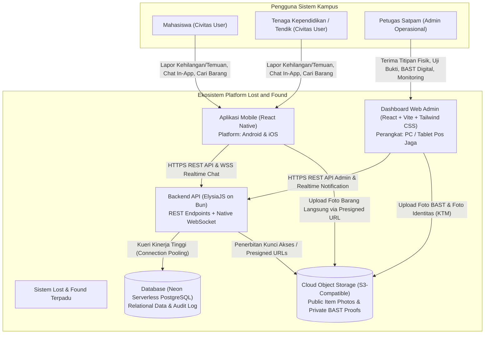
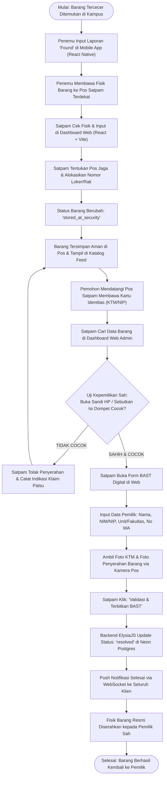
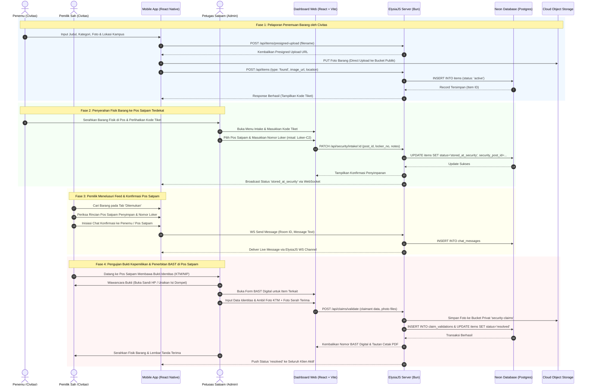
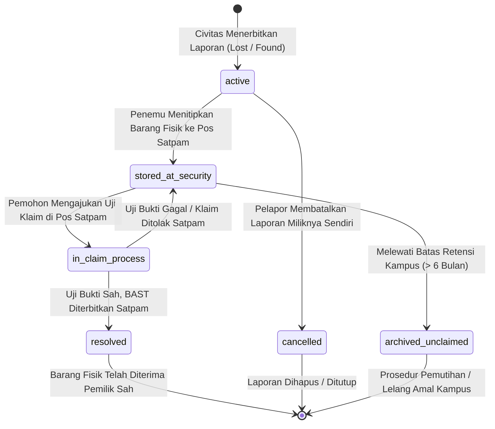
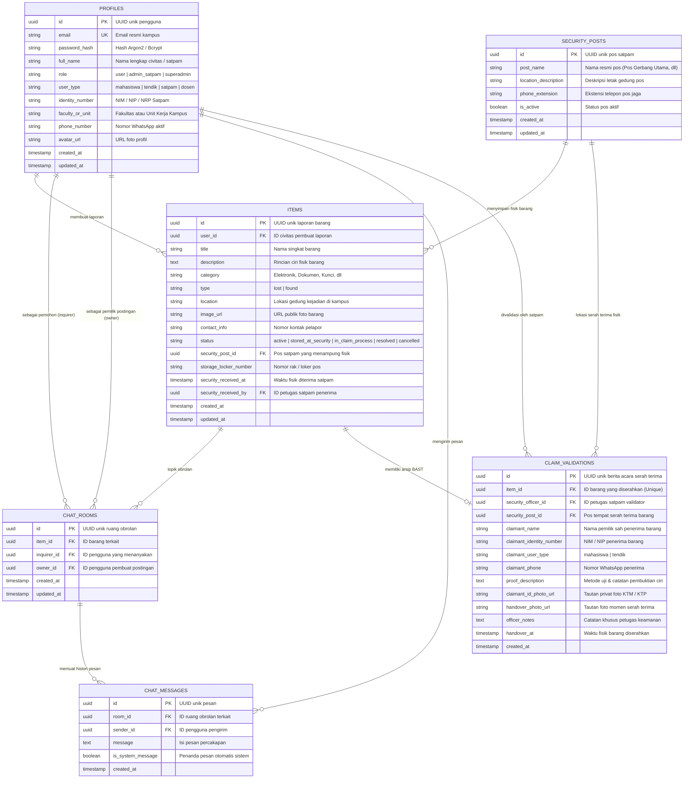

# Dokumen Spesifikasi Kebutuhan Perangkat Lunak (Software Requirements Specification - SRS)
## Sistem Informasi Lost & Found

---

| Dokumen | Spesifikasi Kebutuhan Perangkat Lunak (SRS) |
| :--- | :--- |
| **Nama Sistem** | **Lost & Found (`lostnfound`)** |
| **Versi Dokumen** | 3.0.0-design |
| **Status Dokumen** | *Draft Spesifikasi Rancangan Sistem (Design & Specification Phase)* |
| **Tahapan Proyek** | Fase Perancangan Arsitektur Sistem (Belum Masuk Tahap Implementasi) |
| **Lingkungan Target** | Lingkungan Kampus Terpadu (Perguruan Tinggi / Universitas / Institut) |
| **Aktor Utama** | Civitas Akademika (Mahasiswa & Tendik) dan Admin (Petugas Satpam) |
| **Target Tech Stack** | **Backend**: ElysiaJS (Bun Runtime) <br> **Database**: Neon (Serverless PostgreSQL) <br> **Web Admin**: React + Vite + Tailwind CSS <br> **Mobile App**: React Native |

---

### Riwayat Perubahan Dokumen (Revision History)

| Versi | Tanggal | Penulis | Deskripsi Perubahan |
| :--- | :--- | :--- | :--- |
| **1.0.0** | 2026-09-30 | Tim Rekayasa Perangkat Lunak | Inisiasi konsep awal sistem pencarian barang hilang skala kampus. |
| **2.0.0** | 2026-11-02 | Tim Rekayasa Perangkat Lunak | Restrukturisasi kebutuhan multi-peran (Civitas Mobile + Admin Satpam Web) dan integrasi SOP Pos Satpam. |
| **3.0.0-design** | 2026-11-03 | Tim Arsitektur & Rekayasa Sistem | Pembaruan menyeluruh sebagai **Cetak Biru Desain Murni (Pre-Implementation Blueprint)** dengan target stack modern: **ElysiaJS (Bun)**, **Neon Serverless Postgres**, **React Vite + Tailwind CSS**, dan **React Native**. |

---

## Daftar Isi

1. [Bab 1: Pendahuluan](#1-pendahuluan)
   - 1.1 [Tujuan Dokumen](#11-tujuan-dokumen)
   - 1.2 [Lingkup Produk](#12-lingkup-produk)
   - 1.3 [Audiens Target dan Pembaca yang Dituju](#13-audiens-target-dan-pembaca-yang-dituju)
   - 1.4 [Definisi, Akronim, dan Singkatan](#14-definisi-akronim-dan-singkatan)
   - 1.5 [Referensi Standar](#15-referensi-standar)
   - 1.6 [Ikhtisar Dokumen](#16-ikhtisar-dokumen)
2. [Bab 2: Deskripsi Keseluruhan Sistem](#2-deskripsi-keseluruhan-sistem)
   - 2.1 [Perspektif dan Konteks Produk](#21-perspektif-dan-konteks-produk)
   - 2.2 [Visualisasi Diagram Konteks Sistem (System Context)](#22-visualisasi-diagram-konteks-sistem-system-context)
   - 2.3 [Visualisasi Diagram Use Case dan Matriks Peran (RBAC)](#23-visualisasi-diagram-use-case-dan-matriks-peran-rbac)
   - 2.4 [Karakteristik Pengguna & Persona Kampus](#24-karakteristik-pengguna--persona-kampus)
   - 2.5 [Lingkungan Operasional](#25-lingkungan-operasional)
   - 2.6 [Batasan Desain dan Perancangan Teknologi](#26-batasan-desain-dan-perancangan-teknologi)
   - 2.7 [Asumsi dan Ketergantungan](#27-asumsi-dan-ketergantungan)
3. [Bab 3: Prosedur Operasional Standar (SOP) Pengelolaan Barang Temuan dan Hilang](#3-prosedur-operasional-standar-sop-pengelolaan-barang-temuan-dan-hilang)
   - 3.1 [SOP Alur Penemuan dan Penitipan Fisik ke Pos Satpam](#31-sop-alur-penemuan-dan-penitipan-fisik-ke-pos-satpam)
   - 3.2 [SOP Alur Pelaporan Kehilangan Barang](#32-sop-alur-pelaporan-kehilangan-barang)
   - 3.3 [SOP Alur Validasi Klaim dan Serah Terima di Pos Satpam](#33-sop-alur-validasi-klaim-dan-serah-terima-di-pos-satpam)
   - 3.4 [Visualisasi Diagram Alir Proses Bisnis (Flowchart SOP)](#34-visualisasi-diagram-alir-proses-bisnis-flowchart-sop)
   - 3.5 [Visualisasi Diagram Sekuens Komprehensif (Sequence Diagram)](#35-visualisasi-diagram-sekuens-komprehensif-sequence-diagram)
   - 3.6 [Visualisasi Diagram Siklus Hidup Status Barang (State Diagram)](#36-visualisasi-diagram-siklus-hidup-status-barang-state-diagram)
4. [Bab 4: Arsitektur Perangkat Lunak dan Desain Basis Data](#4-arsitektur-perangkat-lunak-dan-desain-basis-data)
   - 4.1 [Spesifikasi Tumpukan Teknologi Terpilih (Target Tech Stack)](#41-spesifikasi-tumpukan-teknologi-terpilih-target-tech-stack)
   - 4.2 [Visualisasi Arsitektur Sistem & Kontainer (C4 Container Diagram)](#42-visualisasi-arsitektur-sistem--kontainer-c4-container-diagram)
   - 4.3 [Visualisasi Entity Relationship Diagram (ERD)](#43-visualisasi-entity-relationship-diagram-erd)
   - 4.4 [Rancangan Skema Basis Data Fisik (Neon PostgreSQL DDL)](#44-rancangan-skema-basis-data-fisik-neon-postgresql-ddl)
   - 4.5 [Rancangan Kontrak API (ElysiaJS Endpoints Design)](#45-rancangan-kontrak-api-elysiajs-endpoints-design)
5. [Bab 5: Kebutuhan Antarmuka Eksternal](#5-kebutuhan-antarmuka-eksternal)
   - 5.1 [Antarmuka Pengguna (UI Specification: Mobile App & Web Dashboard)](#51-antarmuka-pengguna-ui-specification-mobile-app--web-dashboard)
   - 5.2 [Antarmuka Perangkat Keras (Hardware Interfaces)](#52-antarmuka-perangkat-keras-hardware-interfaces)
   - 5.3 [Antarmuka Perangkat Lunak (Software Interfaces)](#53-antarmuka-perangkat-lunak-software-interfaces)
   - 5.4 [Antarmuka Komunikasi (Communication Interfaces)](#54-antarmuka-komunikasi-communication-interfaces)
6. [Bab 6: Kebutuhan Fungsional Sistem (Functional Requirements)](#6-kebutuhan-fungsional-sistem-functional-requirements)
   - 6.1 [Modul Autentikasi dan Manajemen Profil (FR-AUTH)](#61-modul-autentikasi-dan-manajemen-profil-fr-auth)
   - 6.2 [Modul Manajemen Pelaporan Barang (FR-ITEM)](#62-modul-manajemen-pelaporan-barang-fr-item)
   - 6.3 [Modul Real-time Chat & Koordinasi (FR-CHAT)](#63-modul-real-time-chat--koordinasi-fr-chat)
   - 6.4 [Modul Inventaris Pos Satpam (FR-SECPOS)](#64-modul-inventaris-pos-satpam-fr-secpos)
   - 6.5 [Modul Validasi Klaim & Berita Acara Serah Terima (FR-CLAIM-VAL)](#65-modul-validasi-klaim--berita-acara-serah-terima-fr-claim-val)
   - 6.6 [Modul Dashboard Monitoring & Statistik Admin (FR-ADMIN-DASH)](#66-modul-dashboard-monitoring--statistik-admin-fr-admin-dash)
7. [Bab 7: Kebutuhan Non-Fungsional Sistem (Non-Functional Requirements)](#7-kebutuhan-non-fungsional-sistem-non-functional-requirements)
   - 7.1 [Keamanan dan Privasi Data (Security & Data Privacy)](#71-keamanan-dan-privasi-data-security--data-privacy)
   - 7.2 [Kinerja dan Efisiensi Beban (Performance & Scalability)](#72-kinerja-dan-efisiensi-beban-performance--scalability)
   - 7.3 [Keandalan dan Ketersediaan (Reliability & Availability)](#73-keandalan-dan-ketersediaan-reliability--availability)
   - 7.4 [Kemudahan Penggunaan (Usability & Accessibility)](#74-kemudahan-penggunaan-usability--accessibility)
   - 7.5 [Kemudahan Pemeliharaan (Maintainability & Clean Architecture)](#75-kemudahan-pemeliharaan-maintainability--clean-architecture)
8. [Bab 8: Matriks Keterlacakan Kebutuhan (Traceability Matrix)](#8-matriks-keterlacakan-kebutuhan-traceability-matrix)
9. [Bab 9: Lampiran (Appendices)](#9-lampiran-appendices)
   - 9.1 [Kamus Data Perancangan (Data Dictionary)](#91-kamus-data-perancangan-data-dictionary)
   - 9.2 [Format Standar Berita Acara Serah Terima (BAST) Digital](#92-format-standar-berita-acara-serah-terima-bast-digital)

---

## 1. Pendahuluan

### 1.1 Tujuan Dokumen
Dokumen **Spesifikasi Kebutuhan Perangkat Lunak (Software Requirements Specification - SRS)** ini disusun sebagai cetak biru rancangan arsitektural (*architectural blueprint*) dan spesifikasi kebutuhan menyeluruh untuk pengembangan sistem **Lost & Found (`lostnfound`)**. Dokumen ini dirancang dari tahap awal (*greenfield design*) sebelum masuk ke proses pengkodean, guna memastikan seluruh komponen sistem—mulai dari antarmuka pengguna, arsitektur backend, basis data, hingga prosedur operasional di lapangan—memiliki definisi yang presisi, terukur, dan selaras.

### 1.2 Lingkup Produk
Sistem **Lost & Found** adalah platform terpadu penanganan barang hilang (*lost*) dan barang temuan (*found*) pada lingkungan kampus perguruan tinggi. Sistem memfasilitasi pelaporan digital, penelusuran katalog terverifikasi, komunikasi pesan langsung antar pihak terkait, serta penitipan fisik dan validasi serah terima resmi di **Pos Satpam Kampus**.

Ekosistem sistem terdiri dari:
1. **Aplikasi Mobile (User Client)** berbasis **React Native**: Digunakan oleh **Mahasiswa** dan **Tenaga Kependidikan (Tendik / Dosen)** untuk mempublikasikan laporan, menelusuri katalog feed barang, berkomunikasi via chat, serta memantau status penyimpanan barang di pos satpam.
2. **Dashboard Web (Admin Portal)** berbasis **React + Vite + Tailwind CSS**: Dioperasikan oleh **Petugas Satpam** di pos-pos pengamanan kampus untuk inventarisasi fisik barang masuk (*security intake*), penetapan nomor loker/rak, pengujian bukti kepemilikan, verifikasi kartu identitas (KTM / Kartu Pegawai), penerbitan **Berita Acara Serah Terima (BAST) Digital**, dan visualisasi statistik kehilangan.
3. **Backend Service** berbasis **ElysiaJS (Bun Runtime)**: Layanan peladen berperforma tinggi yang menyediakan REST API berkecepatan tinggi dengan validasi skema tipe data ketat (*TypeBox*), otorisasi peran pengguna berbasis JWT, serta *engine* WebSocket native untuk pesan langsung.
4. **Basis Data Serverless** berbasis **Neon (PostgreSQL)**: Basis data relasional *cloud-native* dengan kapabilitas *serverless pooling*, percabangan data (*database branching*), dan konsistensi ACID penuh.
5. **Cloud Object Storage (S3-Compatible)**: Penyimpanan berkas foto barang (akses publik) dan berkas dokumentasi identitas/BAST (akses privat berbasis URL bertanda tangan / *presigned URLs*).

### 1.3 Audiens Target dan Pembaca yang Dituju
- **Software Architects & Engineers**: Pedoman desain arsitektur, pemodelan data Neon PostgreSQL, implementasi handler ElysiaJS, dan struktur antarmuka klien.
- **UI/UX Designers**: Acuan desain wireframe antarmuka React Native (Mobile) dan React Vite + Tailwind CSS (Web Admin).
- **Petugas Satpam Kampus (Admin Operasional)**: Panduan tata kerja verifikasi fisik, uji klaim, dan pencatatan BAST di pos jaga.
- **Civitas Akademika (Mahasiswa & Tendik)**: Panduan alur keselamatan penitipan barang dan tata cara pengambilan barang temuan.
- **Pimpinan dan Komite Pengamanan Kampus**: Pedoman audit transparansi tata kelola aset yang hilang di lingkungan institusi.

### 1.4 Definisi, Akronim, dan Singkatan
| Istilah / Akronim | Penjelasan Teknis |
| :--- | :--- |
| **SRS** | *Software Requirements Specification* — Dokumen spesifikasi kebutuhan perangkat lunak. |
| **ElysiaJS** | Framework backend berbasis Bun yang mengutamakan kecepatan eksekusi tinggi dan keamanan tipe data *end-to-end*. |
| **Neon** | Layanan basis data serverless PostgreSQL dengan pemisahan komputasi dan penyimpanan (*storage-compute separation*). |
| **Bun** | Runtime JavaScript serba cepat yang bertindak sebagai bundler, package manager, dan runtime engine backend. |
| **Tailwind CSS** | Framework CSS utility-first untuk membangun antarmuka web modern, fleksibel, dan responsif. |
| **Vite** | Frontend tooling generasi baru untuk proses *build* dan pengembangan web modern yang instan. |
| **React Native** | Framework multiplatform untuk pengembangan aplikasi mobile native Android dan iOS. |
| **KTM** | Kartu Tanda Mahasiswa — Kartu identitas resmi mahasiswa aktif di universitas. |
| **NIP / NUPTK** | Nomor Induk Pegawai — Identitas resmi tenaga kependidikan atau staf universitas. |
| **BAST** | Berita Acara Serah Terima — Dokumen digital bukti pengembalian barang temuan kepada pemilik sah. |
| **Presigned URL** | Tautan unduh/unggah berbatas waktu dengan hak akses terbatas untuk objek storage berkeamanan tinggi. |

### 1.5 Referensi Standar
1. IEEE Std 830-1998, *IEEE Recommended Practice for Software Requirements Specifications*.
2. ISO/IEC/IEEE 29148:2018, *Systems and Software Engineering — Life Cycle Processes — Requirements Engineering*.
3. Dokumentasi Resmi ElysiaJS Framework (`elysiajs.com`).
4. Dokumentasi Arsitektur Neon Serverless PostgreSQL (`neon.tech/docs`).
5. Peraturan Standar Operasional Pengamanan Kampus terkait Penanganan Barang Temuan dan Tertinggal.

### 1.6 Ikhtisar Dokumen
Dokumen ini disusun dalam sembilan bab. Bab 2 memaparkan konteks sistem, use case, dan persona pengguna. Bab 3 menjabarkan SOP pengelolaan barang lengkap dengan visualisasi flowchart, sequence diagram, dan state machine. Bab 4 mendefinisikan tumpukan teknologi, arsitektur C4, rancangan DDL Neon PostgreSQL, dan kontrak API ElysiaJS. Bab 5 dan Bab 6 merinci kebutuhan antarmuka dan kebutuhan fungsional. Bab 7 memuat kebutuhan non-fungsional, Bab 8 menyajikan matriks keterlacakan, dan Bab 9 memuat lampiran kamus data serta template standar BAST digital.

---

## 2. Deskripsi Keseluruhan Sistem

### 2.1 Perspektif dan Konteks Produk
Sistem Lost & Found dirancang untuk mentransformasi kebiasaan penyebaran info barang hilang di grup media sosial yang berceceran, tidak aman, dan rawan klaim palsu. Sistem ini menetapkan **Pos Satpam Kampus** sebagai titik pengamanan fisik sentral, didukung oleh katalog daring yang dapat diakses secara transparan melalui aplikasi mobile dan dikelola secara akuntabel oleh petugas keamanan melalui dashboard web.

### 2.2 Visualisasi Diagram Konteks Sistem (System Context)

Diagram konteks berikut memvisualisasikan batas sistem Lost & Found serta interaksinya dengan seluruh entitas luar:



### 2.3 Visualisasi Diagram Use Case dan Matriks Peran (RBAC)

Diagram use case berikut memvisualisasikan batasan fitur bagi masing-masing peran:

```mermaid
flowchart LR
    subgraph Aktor Pengguna
        U(("Civitas Akademika<br>(Mahasiswa & Tendik)"))
        A(("Petugas Satpam<br>(Admin)"))
    end

    subgraph Modul Civitas (Mobile App)
        UC1["Registrasi Akun dengan Identitas Kampus"]
        UC2["Publikasi Laporan Barang Hilang (Lost)"]
        UC3["Publikasi Laporan Barang Ditemukan (Found)"]
        UC4["Eksplorasi & Penyaringan Feed Barang Aktif"]
        UC5["Obrolan Langsung In-App (Real-time Chat)"]
        UC6["Pemantauan Status Pos Penitipan Barang"]
    end

    subgraph Modul Operasional Satpam (Web Dashboard)
        UC7["Pencatatan Fisik Barang Masuk (Security Intake)"]
        UC8["Alokasi Pos Jaga & Nomor Rak/Loker Fisik"]
        UC9["Wawancara Uji Bukti Kepemilikan Sah"]
        UC10["Input Form BAST Digital + Foto Penyerahan"]
        UC11["Validasi Serah Terima & Status Selesai (Resolve)"]
        UC12["Unduh / Cetak Dokumen PDF Berita Acara"]
        UC13["Pemantauan Statistik & Area Rawan Kehilangan"]
    end

    U --> UC1
    U --> UC2
    U --> UC3
    U --> UC4
    U --> UC5
    U --> UC6

    A --> UC1
    A --> UC2
    A --> UC3
    A --> UC4
    A --> UC5
    A --> UC7
    A --> UC8
    A --> UC9
    A --> UC10
    A --> UC11
    A --> UC12
    A --> UC13
```

#### Matriks Hak Akses (Role-Based Access Control)

| Kemampuan / Fungsionalitas Sistem | User (Mahasiswa & Tendik) | Admin (Petugas Satpam) |
| :--- | :---: | :---: |
| Registrasi Mandiri (Email Kampus + NIM/NIP) | ✅ Ya | ❌ Dikelola Administrator |
| Menerbitkan Laporan Barang Hilang (*Lost*) | ✅ Ya | ✅ Ya (dapat bantu pelapor offline) |
| Menerbitkan Laporan Barang Ditemukan (*Found*) | ✅ Ya | ✅ Ya |
| Mengunggah Foto Barang ke Object Storage | ✅ Ya | ✅ Ya |
| Akses Fitur Real-time Chat In-App | ✅ Ya | ✅ Ya |
| Melihat Katalog Feed Barang Terverifikasi | ✅ Ya | ✅ Ya |
| Konfirmasi Fisik Barang Masuk di Pos Satpam (*Intake*) | ❌ Ditolak (403 Forbidden) | ✅ Ya (Otoritas Penuh) |
| Menetapkan Nomor Rak / Loker Penyimpanan Pos | ❌ Ditolak (403 Forbidden) | ✅ Ya |
| Menolak Klaim Fiktif / Upaya Penipuan | ❌ Tidak Memiliki Hak | ✅ Ya |
| Menerbitkan Berita Acara Serah Terima (BAST) Digital | ❌ Ditolak (403 Forbidden) | ✅ Ya (Otoritas Penuh) |
| Memotret Identitas (KTM) & Foto Penyerahan | ❌ Tidak | ✅ Ya |
| Mengubah Status Akhir Barang Menjadi `resolved` | ❌ Tidak | ✅ Ya (Melalui Validasi BAST) |
| Cetak Dokumen PDF Lembar BAST | ❌ Tidak | ✅ Ya |
| Akses Dashboard Metrik & Analisis Titik Rawan | ❌ Ditolak (403 Forbidden) | ✅ Ya |

### 2.4 Karakteristik Pengguna & Persona Kampus
1. **Mahasiswa**:
   - Rentang Usia: 17 – 25 tahun.
   - Perangkat: Ponsel pintar (Android / iOS).
   - Pola Penggunaan: Menuntut akses cepat, antarmuka sederhana menyerupai aplikasi media sosial modern, pelaporan berbasis foto instan, dan notifikasi cepat saat barangnya terindikasi ditemukan.
   - Atribut Identitas: Nama Lengkap, NIM, Fakultas/Jurusan, Nomor WhatsApp.
2. **Tenaga Kependidikan (Tendik / Dosen / Staf)**:
   - Rentang Usia: 24 – 60 tahun.
   - Perangkat: Ponsel pintar atau browser kantor.
   - Pola Penggunaan: Mengutamakan privasi data pribadi dan instruksi yang jelas mengenai titik pos satpam pengambil barang.
   - Atribut Identitas: Nama Lengkap, NIP/NUPTK, Unit Kerja/Bagian, Nomor WhatsApp.
3. **Petugas Satpam (Admin Operasional)**:
   - Rentang Usia: 21 – 55 tahun.
   - Perangkat: Komputer desktop pos satpam atau tablet patroli dengan koneksi WiFi/LAN.
   - Pola Penggunaan: Membutuhkan dashboard berbasis web yang bersih, kontras tinggi, navigasi minim klik, pencarian instan nomor tiket, dan integrasi webcam untuk dokumentasi penyerahan barang.
   - Atribut Identitas: Nama Lengkap, Nomor Registrasi Petugas (NRP/NIK), Pos Jaga Bertugas.

### 2.5 Lingkungan Operasional
- **Sisi Klien Pengguna (Mobile)**: React Native (mendukung Android 10+ dan iOS 15+).
- **Sisi Klien Admin (Web Dashboard)**: React + Vite + Tailwind CSS (berjalan optimal pada Google Chrome 100+, Firefox 100+, Safari 15+, dan Microsoft Edge 100+ dengan resolusi minimum 1024x768 piksel).
- **Sisi Peladen (Backend API)**: Bun runtime v1.1+ mengeksekusi framework ElysiaJS pada container Linux (Docker / Serverless Container).
- **Sisi Basis Data Relasional**: Neon Serverless PostgreSQL v16 dengan integrasi connection pooling (pgbouncer).
- **Sisi Penyimpanan Berkas**: S3-Compatible Cloud Storage (Cloudflare R2 / AWS S3 / MinIO).

### 2.6 Batasan Desain dan Perancangan Teknologi
1. **Pemusatan Fisik Barang**: Demi alasan hukum dan keselamatan, barang berharga yang ditemukan tidak diserahterimakan secara privat antar mahasiswa, melainkan **wajib dititipkan ke Pos Satpam Kampus**.
2. **Kerahasiaan Bukti Identitas (UU Perlindungan Data Pribadi)**: Foto identitas (KTM / Kartu Pegawai) yang diambil saat proses BAST wajib disimpan dalam bucket storage terproteksi dengan pembatasan hak akses via *presigned URL* berdurasi terbatas.
3. **Validasi Tipe Data End-to-End**: Seluruh request body, query params, dan response schema divalidasi pada level runtime menggunakan TypeBox dari ElysiaJS untuk mencegah ancaman *injection* dan inkonsistensi skema.
4. **Konektivitas Jaringan**: Aplikasi mobile harus menangani fluktuasi sinyal di area parkir basemen kampus melalui penanganan state jaringan yang anggun (*graceful offline notification*).

### 2.7 Asumsi dan Ketergantungan
1. Pos satpam yang bertindak sebagai pos penitipan telah dilengkapi gawai komputer/tablet dengan akses internet stabil dan perangkat kamera fungsional.
2. Seluruh civitas akademika yang menggunakan sistem memiliki akun email resmi institusi atau nomor identitas valid (NIM/NIP) yang terverifikasi.
3. Layanan cloud Neon PostgreSQL dan Cloud Storage memiliki ketersediaan minimal 99.5%.

---

## 3. Prosedur Operasional Standar (SOP) Pengelolaan Barang Temuan dan Hilang

### 3.1 SOP Alur Penemuan dan Penitipan Fisik ke Pos Satpam
1. **Penemuan Barang**: Civitas (Mahasiswa/Tendik) menemukan barang tercecer di lingkungan kampus (ruang kelas, kantin, perpustakaan, tempat ibadah, atau parkir).
2. **Pelaporan Mandiri di Mobile App**: Penemu membuka aplikasi Lost & Found di ponsel, memilih menu **Lapor Ditemukan (Found)**, memotret fisik barang, mengisi deskripsi umum dan lokasi penemuan, lalu mengirim laporan. Sistem menerbitkan kode tiket pelaporan.
3. **Penyerahan Fisik ke Pos Satpam**: Penemu membawa barang fisik tersebut ke Pos Satpam terdekat (maksimal $2 \times 24$ jam) dan menunjukkan kode tiket dari aplikasi.
4. **Pencatatan Fisik oleh Satpam**:
   - Petugas Satpam membuka **Dashboard Web Admin** pada menu **Penerimaan Barang Fisik (Intake)**.
   - Petugas memasukkan kode tiket atau mencari judul barang.
   - Petugas memeriksa fisik barang, memilih nama Pos Satpam penjaga, menentukan nomor rak/loker penyimpanan (misal: *Loker B-04*), dan mengisi catatan kondisi fisik.
   - Petugas menekan tombol **"Konfirmasi Penerimaan Fisik"**.
   - Sistem memperbarui status barang menjadi `stored_at_security`. Penemu menerima tanda terima digital di aplikasi.

### 3.2 SOP Alur Pelaporan Kehilangan Barang
1. **Pelaporan Kehilangan**: Mahasiswa/Tendik yang kehilangan barang membuka aplikasi mobile, memilih menu **Lapor Kehilangan (Lost)**, menginput nama barang, kategori, perkiraan lokasi terakhir terlihat (*last seen*), serta deskripsi ciri umum.
2. **Penelusuran Mandiri**: Pengguna membuka tab feed **Ditemukan** dengan filter status `stored_at_security` untuk melihat barang-barang yang sudah tersimpan di pos satpam.
3. **Koordinasi Awal**: Pengguna dapat memanfaatkan fitur chat in-app untuk menanyakan rincian barang kepada pelapor awal atau ke akun resmi pos satpam.
4. **Arahan Pengambilan**: Aplikasi menegaskan bahwa barang fisik tersimpan aman di Pos Satpam dan mewajibkan pemilik untuk datang langsung ke pos terkait.

### 3.3 SOP Alur Validasi Klaim dan Serah Terima di Pos Satpam
1. **Kedatangan Pemilik Sah**: Pemohon mendatangi Pos Satpam tempat barang disimpan dengan menunjukkan kartu identitas resmi (**KTM** untuk mahasiswa atau **Kartu Pegawai/NIP** untuk tendik/dosen).
2. **Uji Validasi Kepemilikan oleh Petugas Satpam**:
   - Satpam membuka rincian postingan barang di Dashboard Web.
   - Satpam mengajukan pertanyaan verifikasi rahasia:
     - Gawai/Laptop: Meminta pemohon membuka kunci layar (*PIN/Password/Pola*), menunjukkan email yang terhubung, atau mencocokkan nomor IMEI/serial.
     - Dompet/Tas: Meminta pemohon menyebutkan nominal uang tunai, rincian kartu di dalam dompet, atau foto keluarga yang tersimpan.
     - Kunci Kendaraan: Menguji anak kunci pada kendaraan yang terparkir di lokasi kampus.
3. **Penerbitan Berita Acara Serah Terima (BAST) Digital**:
   - Jika bukti kepemilikan terbukti sahih, Satpam menekan tombol **"Validasi Serah Terima (BAST)"** pada Dashboard Web.
   - Satpam melengkapi formulir BAST digital:
     - Nama Lengkap Pemilik Sah.
     - Nomor Identitas (NIM / NIP).
     - Fakultas / Unit Kerja Kampus.
     - Nomor Telepon / WhatsApp Aktif.
     - Rincian metode pembuktian kepemilikan yang berhasil diverifikasi.
     - Pengambilan foto kartu identitas (KTM/Kartu Pegawai) via kamera web pos.
     - Pengambilan foto dokumentasi serah terima antara satpam dan pemilik barang.
4. **Penyelesaian Status (Resolution)**:
   - Satpam menekan tombol **"Terbitkan BAST & Selesaikan (Mark as Resolved)"**.
   - Sistem memperbarui status barang menjadi `resolved`.
   - Ruang obrolan terkait ditutup dengan notifikasi sistem resmi.
   - Barang fisik diserahkan kepada pemilik sah.

### 3.4 Visualisasi Diagram Alir Proses Bisnis (Flowchart SOP)



### 3.5 Visualisasi Diagram Sekuens Komprehensif (Sequence Diagram)



### 3.6 Visualisasi Diagram Siklus Hidup Status Barang (State Diagram)



---

## 4. Arsitektur Perangkat Lunak dan Desain Basis Data

### 4.1 Spesifikasi Tumpukan Teknologi Terpilih (Target Tech Stack)

Rancangan sistem Lost & Found menetapkan tumpukan teknologi modern dengan karakteristik performa tinggi, konsumsi sumber daya ringan, dan keamanan tipe data ketat:

1. **Backend Framework**: **ElysiaJS** berjalan di atas **Bun Runtime**.
   - Menyediakan kecepatan pemrosesan I/O sangat tinggi, konsumsi memori rendah, dan waktu *cold-start* instan.
   - Validasi skema tipe data otomatis menggunakan pustaka **TypeBox**.
   - Manajemen otentikasi token JWT menggunakan plugin resmi `@elysiajs/jwt`.
   - Real-time WebSockets menggunakan handler native `elysia.ws()`.
2. **Database Engine**: **Neon (Serverless PostgreSQL)**.
   - Kompatibilitas penuh dengan standar PostgreSQL versi 16.
   - Fitur *serverless branching* untuk kemudahan isolasi lingkungan pengembangan, pengujian, dan produksi.
   - Dilengkapi *connection pooler* bawaan untuk menangani ribuan koneksi konkuren tanpa membebani memori peladen.
3. **Frontend Web Admin**: **React** (v18+) dibundel dengan **Vite** dan distilasi menggunakan **Tailwind CSS**.
   - Portal web khusus Petugas Satpam di pos penjagaan dengan *Hot Module Replacement (HMR)* super cepat.
   - Tailwind CSS menjamin desain antarmuka responsif, konsisten, dan mudah disesuaikan untuk layar monitor maupun tablet.
4. **Mobile Client**: **React Native** (kompatibel dengan ekosistem Expo).
   - Satu basis kode lintas platform untuk perangkat Android dan iOS.
   - Akses native ke kamera perangkat, sistem berkas, dan notifikasi gawai.
5. **Storage Layer**: **Cloud Object Storage (S3-Compatible Protocol)**.
   - Bucket Publik: Menampung citra foto laporan barang (`items/public`).
   - Bucket Privat: Menampung citra foto identitas (KTM/NIP) dan foto serah terima BAST (`bast/private`) dengan proteksi *presigned access URL*.

### 4.2 Visualisasi Arsitektur Sistem & Kontainer (C4 Container Diagram)

```mermaid
flowchart TD
    subgraph Klien Pengguna
        MOB["Aplikasi Mobile (React Native)<br>Target: Android & iOS<br>- Antarmuka Pelaporan & Feed<br>- Live Chat In-App Client<br>- Client-side Image Compression"]
    end

    subgraph Klien Admin Satpam
        WEB["Dashboard Web Admin (React + Vite + Tailwind CSS)<br>Target: Desktop PC / Tablet Pos Jaga<br>- Modul Penerimaan Fisik (Intake)<br>- Modul Inventaris Loker Pos<br>- Form BAST Digital + Integrasi Webcam<br>- Panel Metrik & Monitoring Hotspot"]
    end

    subgraph Backend Application Layer (ElysiaJS on Bun)
        API["ElysiaJS HTTP & WebSocket Server<br>Port: 5000"]
        
        subgraph Elysia Middlewares
            M_AUTH["Auth Plugin (@elysiajs/jwt)<br>Bearer Token Verification"]
            M_RBAC["RBAC Guard<br>Role: user vs admin_satpam"]
            M_VAL["TypeBox Schema Validation<br>Strict Payload & Query Validation"]
            M_CORS["CORS & Helmet Security Headers"]
        end

        subgraph Route Handlers
            H_AUTH["/api/auth (Login, Register, Me)"]
            H_ITEM["/api/items (CRUD, Search, Filter)"]
            H_SEC["/api/security (Intake, Lockers, Posts)"]
            H_CLAIM["/api/claims (BAST Validate, Export PDF)"]
            H_WS["/ws/chat (Real-time PubSub WebSocket)"]
        end
    end

    subgraph Cloud Infrastructure
        NEON[("Neon Serverless PostgreSQL<br>- Tables: profiles, items, posts, claims, chat<br>- Connection Pooling (PgBouncer)<br>- Automatic Branching")]
        STORAGE[("S3-Compatible Object Storage<br>- Bucket Publik: item-images<br>- Bucket Privat: security-claims")]
    end

    MOB -->|"HTTPS REST API Requests"| API
    MOB -->|"WSS (Live Chat Channel)"| H_WS
    MOB -->|"Upload Foto Barang via Presigned URL"| STORAGE

    WEB -->|"HTTPS REST API Admin"| API
    WEB -->|"Upload Foto BAST / KTM via Presigned URL"| STORAGE

    API --> M_CORS
    M_CORS --> M_AUTH
    M_AUTH --> M_RBAC
    M_RBAC --> M_VAL

    M_VAL --> H_AUTH & H_ITEM & H_SEC & H_CLAIM & H_WS

    H_AUTH --> NEON
    H_ITEM --> NEON
    H_SEC --> NEON
    H_CLAIM --> NEON
    H_WS --> NEON
    H_ITEM --> STORAGE
    H_CLAIM --> STORAGE
```

### 4.3 Visualisasi Entity Relationship Diagram (ERD)



### 4.4 Rancangan Skema Basis Data Fisik (Neon PostgreSQL DDL)

Skrip DDL berikut merupakan cetak biru skema basis data relasional yang dirancang untuk dieksekusi pada Neon Serverless PostgreSQL:

```sql
-- ====================================================================
-- CETAK BIRU BASIS DATA SISTEM LOST & FOUND
-- Target RDBMS: Neon Serverless PostgreSQL v16+
-- ====================================================================

-- Ekstensi pgcrypto untuk pembuatan UUID v4
CREATE EXTENSION IF NOT EXISTS "pgcrypto";

-- 1. Tabel Profil Pengguna (Profiles)
CREATE TABLE IF NOT EXISTS public.profiles (
    id UUID PRIMARY KEY DEFAULT gen_random_uuid(),
    email VARCHAR(255) NOT NULL UNIQUE,
    password_hash VARCHAR(255) NOT NULL,
    full_name VARCHAR(255) NOT NULL,
    role VARCHAR(30) NOT NULL DEFAULT 'user' 
        CHECK (role IN ('user', 'admin_satpam', 'superadmin')),
    user_type VARCHAR(30) NOT NULL DEFAULT 'mahasiswa' 
        CHECK (user_type IN ('mahasiswa', 'tendik', 'satpam', 'dosen', 'umum')),
    identity_number VARCHAR(100) NOT NULL,
    faculty_or_unit VARCHAR(150),
    phone_number VARCHAR(50),
    avatar_url TEXT,
    created_at TIMESTAMPTZ NOT NULL DEFAULT NOW(),
    updated_at TIMESTAMPTZ NOT NULL DEFAULT NOW()
);

-- 2. Master Tabel Pos Satpam Resmi Kampus (Security Posts)
CREATE TABLE IF NOT EXISTS public.security_posts (
    id UUID PRIMARY KEY DEFAULT gen_random_uuid(),
    post_name VARCHAR(150) NOT NULL UNIQUE,
    location_description TEXT NOT NULL,
    phone_extension VARCHAR(50),
    is_active BOOLEAN NOT NULL DEFAULT true,
    created_at TIMESTAMPTZ NOT NULL DEFAULT NOW(),
    updated_at TIMESTAMPTZ NOT NULL DEFAULT NOW()
);

-- Inisialisasi Titik Jaga Pos Satpam Kampus
INSERT INTO public.security_posts (post_name, location_description, phone_extension)
VALUES 
    ('Pos 1 - Gerbang Utama Kampus', 'Gedung jaga gerbang utama universitas', '101'),
    ('Pos 2 - Gedung Rektorat & Perpustakaan', 'Lobby barat gedung pusat administrasi lantai 1', '102'),
    ('Pos 3 - Zona Fakultas Teknik & Sains', 'Pos persimpangan Gedung Laboratorium Terpadu', '103'),
    ('Pos 4 - Gelanggang Olahraga & Parkir Timur', 'Pintu masuk kawasan pusat olahraga', '104')
ON CONFLICT (post_name) DO NOTHING;

-- 3. Tabel Laporan Barang Hilang & Temuan (Items)
CREATE TABLE IF NOT EXISTS public.items (
    id UUID PRIMARY KEY DEFAULT gen_random_uuid(),
    user_id UUID NOT NULL REFERENCES public.profiles(id) ON DELETE CASCADE,
    title VARCHAR(255) NOT NULL,
    description TEXT NOT NULL DEFAULT '',
    category VARCHAR(100) NOT NULL DEFAULT 'Lainnya',
    type VARCHAR(20) NOT NULL CHECK (type IN ('lost', 'found')),
    location VARCHAR(255) NOT NULL,
    image_url TEXT,
    contact_info VARCHAR(255),
    status VARCHAR(30) NOT NULL DEFAULT 'active' 
        CHECK (status IN ('active', 'stored_at_security', 'in_claim_process', 'resolved', 'cancelled')),
    security_post_id UUID REFERENCES public.security_posts(id) ON DELETE SET NULL,
    storage_locker_number VARCHAR(100),
    security_received_at TIMESTAMPTZ,
    security_received_by UUID REFERENCES public.profiles(id) ON DELETE SET NULL,
    created_at TIMESTAMPTZ NOT NULL DEFAULT NOW(),
    updated_at TIMESTAMPTZ NOT NULL DEFAULT NOW()
);

-- 4. Tabel Berita Acara Serah Terima / Validasi Klaim (Claim Validations)
CREATE TABLE IF NOT EXISTS public.claim_validations (
    id UUID PRIMARY KEY DEFAULT gen_random_uuid(),
    item_id UUID NOT NULL UNIQUE REFERENCES public.items(id) ON DELETE CASCADE,
    security_officer_id UUID NOT NULL REFERENCES public.profiles(id) ON DELETE RESTRICT,
    security_post_id UUID NOT NULL REFERENCES public.security_posts(id) ON DELETE RESTRICT,
    claimant_name VARCHAR(255) NOT NULL,
    claimant_identity_number VARCHAR(100) NOT NULL,
    claimant_user_type VARCHAR(50) NOT NULL DEFAULT 'mahasiswa',
    claimant_phone VARCHAR(50) NOT NULL,
    proof_description TEXT NOT NULL,
    claimant_id_photo_url TEXT,
    handover_photo_url TEXT NOT NULL,
    officer_notes TEXT,
    handover_at TIMESTAMPTZ NOT NULL DEFAULT NOW(),
    created_at TIMESTAMPTZ NOT NULL DEFAULT NOW()
);

-- 5. Tabel Ruang Obrolan Terkait Barang (Chat Rooms)
CREATE TABLE IF NOT EXISTS public.chat_rooms (
    id UUID PRIMARY KEY DEFAULT gen_random_uuid(),
    item_id UUID NOT NULL REFERENCES public.items(id) ON DELETE CASCADE,
    inquirer_id UUID NOT NULL REFERENCES public.profiles(id) ON DELETE CASCADE,
    owner_id UUID NOT NULL REFERENCES public.profiles(id) ON DELETE CASCADE,
    created_at TIMESTAMPTZ NOT NULL DEFAULT NOW(),
    updated_at TIMESTAMPTZ NOT NULL DEFAULT NOW(),
    CONSTRAINT unique_item_chat_participants UNIQUE(item_id, inquirer_id, owner_id)
);

-- 6. Tabel Pesan Obrolan (Chat Messages)
CREATE TABLE IF NOT EXISTS public.chat_messages (
    id UUID PRIMARY KEY DEFAULT gen_random_uuid(),
    room_id UUID NOT NULL REFERENCES public.chat_rooms(id) ON DELETE CASCADE,
    sender_id UUID NOT NULL REFERENCES public.profiles(id) ON DELETE CASCADE,
    message TEXT NOT NULL,
    is_system_message BOOLEAN NOT NULL DEFAULT false,
    created_at TIMESTAMPTZ NOT NULL DEFAULT NOW()
);

-- Pembuatan Indeks Kinerja Tinggi untuk Kueri Skala Besar di Neon
CREATE INDEX IF NOT EXISTS idx_items_status_type ON public.items(status, type);
CREATE INDEX IF NOT EXISTS idx_items_security_post ON public.items(security_post_id);
CREATE INDEX IF NOT EXISTS idx_items_created_at ON public.items(created_at DESC);
CREATE INDEX IF NOT EXISTS idx_chat_rooms_participants ON public.chat_rooms(inquirer_id, owner_id);
CREATE INDEX IF NOT EXISTS idx_chat_messages_room ON public.chat_messages(room_id, created_at ASC);
CREATE INDEX IF NOT EXISTS idx_profiles_role ON public.profiles(role);
```

### 4.5 Rancangan Kontrak API (ElysiaJS Endpoints Design)

Berikut adalah rancangan pemetaan rute API yang akan diimplementasikan pada ElysiaJS:

| Method | Endpoint | Deskripsi Fungsi | Akses Otorisasi |
| :--- | :--- | :--- | :---: |
| `POST` | `/api/auth/register` | Mendaftarkan akun mahasiswa/tendik baru | Publik |
| `POST` | `/api/auth/login` | Autentikasi kredensial & penerbitan token JWT | Publik |
| `GET` | `/api/auth/me` | Mengambil data profil pengguna yang sedang login | Wajib (Bearer JWT) |
| `GET` | `/api/items` | Penelusuran katalog barang (filter: `type`, `status`, `category`, `search`) | Publik |
| `GET` | `/api/items/:id` | Mengambil detail lengkap barang & info pos penjaga | Publik |
| `POST` | `/api/items` | Mempublikasikan laporan barang hilang/temuan | Wajib (Bearer JWT) |
| `POST` | `/api/items/presigned-upload` | Meminta presigned URL untuk upload foto barang | Wajib (Bearer JWT) |
| `PATCH`| `/api/items/:id` | Mengubah rincian laporan milik sendiri | Wajib (Pemilik) |
| `DELETE`| `/api/items/:id` | Membatalkan laporan milik sendiri | Wajib (Pemilik) |
| `GET` | `/api/security/posts` | Daftar seluruh pos satpam resmi di kampus | Publik |
| `PATCH`| `/api/security/intake/:id` | Konfirmasi fisik barang diterima di pos satpam & set nomor loker | Wajib (`admin_satpam`) |
| `PATCH`| `/api/security/relocate/:id`| Memindahkan catatan loker/rak barang di pos | Wajib (`admin_satpam`) |
| `POST` | `/api/claims/validate` | Memvalidasi uji kepemilikan, input BAST & set status `resolved` | Wajib (`admin_satpam`) |
| `GET` | `/api/claims/:id` | Rincian data berita acara serah terima (BAST) | Wajib (Satpam/Pemilik) |
| `GET` | `/api/claims/:id/export-pdf`| Mengunduh dokumen cetak BAST berformat PDF resmi | Wajib (`admin_satpam`) |
| `GET` | `/api/admin/metrics` | Data analitik KPI: barang masuk, tersimpan, persentase kembali | Wajib (`admin_satpam`) |
| `GET` | `/api/admin/hotspots` | Statistik sebaran gedung kampus rawan barang hilang | Wajib (`admin_satpam`) |
| `POST` | `/api/chat/rooms` | Membuat atau membuka ruang obrolan terkait barang | Wajib (Bearer JWT) |
| `GET` | `/api/chat/rooms` | Mengambil daftar seluruh riwayat percakapan pengguna | Wajib (Bearer JWT) |
| `GET` | `/api/chat/rooms/:id/messages`| Mengambil histori pesan percakapan suatu room | Wajib (Partisipan) |
| `WS` | `/ws/chat` | Saluran WebSocket native ElysiaJS untuk pesan instan | Wajib (Token Handshake) |

---

## 5. Kebutuhan Antarmuka Eksternal

### 5.1 Antarmuka Pengguna (UI Specification: Mobile App & Web Dashboard)

#### 5.1.1 Aplikasi Mobile (React Native — Civitas Akademika)
1. **Layar Masuk & Pendaftaran**:
   - Input: Nama Lengkap, Email Kampus, Kata Sandi, Pilihan Status (Mahasiswa/Tendik), Nomor Identitas (NIM/NIP), dan No WhatsApp.
   - Validasi formulir di sisi klien (*real-time inline validation*).
2. **Layar Feed Beranda**:
   - Segmented Tab Kontrol: **Barang Hilang** vs **Barang Ditemukan**.
   - Kolom pencarian instan (*debounced search bar*) mencari judul, gedung, atau ciri barang.
   - Chip Filter Kategori horizontal: *Semua, Elektronik, Dokumen, Dompet/Tas, Kunci, Pakaian, Lainnya*.
   - Kartu Barang memuat foto, judul, badge lokasi gedung, badge status visual (Oranye: Hilang, Biru: Ditemukan, Hijau: Tersimpan di Pos Satpam, Abu-abu: Selesai).
3. **Layar Formulir Lapor Barang**:
   - Pilihan tipe laporan (*Hilang* / *Ditemukan*).
   - Pratinjau foto kamera/galeri dengan fitur kompresi otomatis di bawah 500 KB sebelum dikirim.
   - Dropdown daftar zona gedung kampus dan isian deskripsi lokasi spesifik.
   - Banner imbauan: *"Barang temuan fisik wajib diserahkan ke Pos Satpam terdekat dalam kurun waktu 2x24 jam."*
4. **Layar Detail Barang**:
   - Tampilan karusel foto resolusi tinggi.
   - Banner informasi fisik pos jaga: menampilkan nama Pos Satpam, ekstensi telepon pos, dan nomor rak/loker jika barang telah diterima satpam.
   - Tombol aksi: **"Hubungi Pelapor via Chat"** atau **"Panduan Menuju Pos Satpam"**.
5. **Layar Percakapan Real-time**:
   - Gelembung percakapan (*chat bubbles*) dengan stempel waktu, status terkirim/terbaca, dan integrasi pesan otomatis sistem saat barang berstatus `resolved`.

#### 5.1.2 Dashboard Web Admin (React + Vite + Tailwind CSS — Petugas Satpam)
1. **Halaman Autentikasi Petugas (`/admin/login`)**:
   - Form masuk aman dengan proteksi pembatasan akses hanya bagi akun dengan peran `admin_satpam`.
2. **Panel Ringkasan Dashboard (`/admin/dashboard`)**:
   - Kartu Metrik Ringkasan: *Barang Masuk Hari Ini*, *Barang Tersimpan di Pos Jaga*, *Klaim Menunggu Validasi*, *Barang Berhasil Diserahkan (Resolved)*.
   - Grafik interaktif persebaran insiden barang hilang/tercecer menurut gedung fakultas.
   - Tabel notifikasi cepat untuk laporan temuan baru civitas yang belum diserahkan fisiknya ke pos jaga.
3. **Halaman Inventaris Fisik Pos (`/admin/inventory`)**:
   - Tabel inventaris memuat ID tiket, thumbnail foto, nama barang, pos penjaga, nomor rak/loker, tanggal masuk, dan tombol aksi cepat.
   - Fitur pencarian instan berdasarkan kode loker atau nama barang.
4. **Halaman Penerimaan Barang Fisik Masuk (`/admin/intake`)**:
   - Form pencatatan serah terima fisik dari penemu ke satpam: verifikasi kesesuaian fisik, alokasi nomor rak/loker, dan pencatatan kondisi barang.
5. **Halaman Validasi Klaim & BAST Digital (`/admin/claims/verify`)**:
   - Panel komparasi antara laporan asli dengan keterangan pemohon.
   - Form input identitas pemilik: Nama, NIM/NIP, Fakultas/Unit, No WhatsApp.
   - Modul antarmuka kamera (webcam PC/tablet) untuk menangkap foto KTM/Kartu Pegawai pemohon dan memotret momen serah terima barang secara fisik.
   - Tombol eksekusi: **"Validasi Sah & Terbitkan BAST Digital"**.
6. **Halaman Arsip & Cetak Lembar BAST (`/admin/claims/archive`)**:
   - Repositori pencarian berita acara serah terima masa lalu.
   - Tombol cetak langsung (*print preview*) atau ekspor lembar BAST resmi ke format PDF.

### 5.2 Antarmuka Perangkat Keras (Hardware Interfaces)
- **Kamera Ponsel Cerdas**: Pengambilan foto barang hilang/temuan langsung dari aplikasi React Native.
- **Webcam / Kamera Tablet Pos Satpam**: Digunakan oleh Dashboard Web untuk mendokumentasikan foto identitas (KTM/NIP) dan foto serah terima barang di pos jaga.
- **Fasilitas Loker dan Rak Pos Satpam**: Lemari loker fisik bernomor dan rak terkunci di pos-pos pengamanan kampus yang dipetakan langsung dengan atribut `storage_locker_number`.

### 5.3 Antarmuka Perangkat Lunak (Software Interfaces)
- **ElysiaJS Backend Engine**: Berjalan pada Bun runtime, menangani seluruh komputasi logika bisnis dan otorisasi JWT.
- **Neon Serverless PostgreSQL**: Layanan basis data relasional awan yang dihubungkan melalui driver connection pooler `@neondatabase/serverless` atau Drizzle ORM.
- **Cloud Object Storage (S3-Compatible API)**: Layanan penyimpanan berkas foto berbasis protokol S3 standar (Cloudflare R2 / AWS S3) menggunakan presigned URLs.

### 5.4 Antarmuka Komunikasi (Communication Interfaces)
- **Protokol HTTPS (TLS 1.3)**: Mengamankan seluruh komunikasi REST API antar klien dan peladen.
- **Protokol WSS (WebSocket Secure)**: Kanal komunikasi dupleks penuh (*full-duplex*) berlatensi rendah untuk fitur live chat in-app dan siaran status barang.
- **Format Pertukaran Data**: Format data terstandarisasi **JSON (JavaScript Object Notation)** dengan pengkodean karakter `UTF-8`.

---

## 6. Kebutuhan Fungsional Sistem (Functional Requirements)

### 6.1 Modul Autentikasi dan Manajemen Profil (FR-AUTH)

#### FR-AUTH-01: Registrasi Akun Civitas Akademika
- **Deskripsi**: Sistem melayani pendaftaran akun baru bagi mahasiswa dan tendik dengan menginput nama lengkap, email resmi kampus, kata sandi, tipe akun (mahasiswa/tendik), dan nomor identitas (NIM/NIP).
- **Aktor**: Mahasiswa, Tendik.
- **Prasyarat**: Email belum terdaftar di basis data.
- **Alur Utama**:
  1. Pengguna mengisi form registrasi di aplikasi mobile React Native.
  2. Sistem memvalidasi kelengkapan data (panjang sandi $\ge 6$ karakter, format email institusi valid).
  3. Backend ElysiaJS mengenkripsi kata sandi menggunakan hashing modern (Argon2 / Bcrypt) dan menyimpan data ke tabel `profiles` di Neon Postgres dengan role default `'user'`.
- **Keluaran**: Akun terbentuk dan token JWT sesi dikembalikan ke klien.

#### FR-AUTH-02: Masuk Akun Pengguna & Admin Satpam (Login)
- **Deskripsi**: Sistem memvalidasi kredensial email dan kata sandi, lalu mengidentifikasi peran pengguna (`user` atau `admin_satpam`).
- **Aktor**: Seluruh Pengguna.
- **Aturan Bisnis**: Akun dengan role `user` hanya diberikan hak akses pada aplikasi mobile, sedangkan akun dengan role `admin_satpam` memiliki wewenang untuk masuk ke Dashboard Web Admin.

#### FR-AUTH-03: Pembatasan Hak Akses Berbasis Peran (RBAC Guard)
- **Deskripsi**: Middleware backend memeriksa keabsahan token JWT dan klaim peran (`role`) pada setiap permintaan ke endpoint administrasi pos satpam dan validasi BAST. Permintaan tanpa izin ditolak dengan kode status HTTP `403 Forbidden`.
- **Aktor**: Sistem Backend ElysiaJS.

---

### 6.2 Modul Manajemen Pelaporan Barang (FR-ITEM)

#### FR-ITEM-01: Publikasi Laporan Barang Hilang / Temuan
- **Deskripsi**: Pengguna dapat mempublikasikan laporan baru dengan memilih tipe (`lost` atau `found`), mengunggah foto, menentukan kategori, menuliskan judul, deskripsi, dan lokasi spesifik di kampus.
- **Aktor**: Mahasiswa, Tendik, Petugas Satpam.
- **Keluaran**: Data tersimpan di tabel `items` dengan status inisial `active`.

#### FR-ITEM-02: Penelusuran & Penyaringan Feed Barang
- **Deskripsi**: Sistem menyediakan kemampuan pencarian teks (*full-text search*) serta penyaringan multi-parameter berdasarkan status barang, kategori, gedung kampus, dan rentang tanggal kejadian.
- **Aktor**: Seluruh Pengguna.

#### FR-ITEM-03: Perubahan Rincian & Pembatalan Laporan Mandiri
- **Deskripsi**: Pembuat laporan berhak menyunting data atau membatalkan laporannya selama status barang masih `active` dan belum tercatat masuk ke pos satpam.
- **Aktor**: Pemilik Laporan (User).

---

### 6.3 Modul Real-time Chat & Koordinasi (FR-CHAT)

#### FR-CHAT-01: Pembuatan Ruang Obrolan Terkait Barang
- **Deskripsi**: Pengguna dapat membuka percakapan aman terkait suatu barang tertentu tanpa memperlihatkan nomor kontak secara publik.
- **Aktor**: Mahasiswa, Tendik, Petugas Satpam.
- **Aturan Bisnis**: Sistem menolak inisiasi chat dengan diri sendiri. Satu pasangan pengguna pada satu barang hanya memiliki tepat satu ruang chat unik.

#### FR-CHAT-02: Pengiriman Pesan Instan Real-time via WebSocket
- **Deskripsi**: Mengirimkan dan menerima pesan instan teks secara sinkron menggunakan saluran WebSocket ElysiaJS native (`/ws/chat`).
- **Aktor**: Pengguna di dalam Ruang Obrolan.

---

### 6.4 Modul Inventaris Pos Satpam (FR-SECPOS)

#### FR-SECPOS-01: Penerimaan Fisik Barang Temuan di Pos Satpam (Security Intake)
- **Deskripsi**: Petugas Satpam menerima titipan barang fisik dari penemu, mengonfirmasi kesesuaian barang pada Dashboard Web, memilih Pos Satpam penjaga, mengalokasikan nomor rak/loker, dan mencatat kondisi fisik barang.
- **Aktor**: Petugas Satpam (Admin).
- **Alur Utama**:
  1. Satpam memasukkan kode tiket laporan barang temuan di Dashboard Web.
  2. Satpam memilih nama Pos Satpam dan memasukkan kode rak/loker penyimpanan (misal: *Loker B-02*).
  3. Satpam menekan tombol konfirmasi penerimaan fisik.
  4. Backend ElysiaJS memperbarui status barang menjadi `stored_at_security`, mencatat stempel waktu `security_received_at`, dan merekam ID satpam penerima `security_received_by`.
- **Keluaran**: Status barang terbarui di sistem; civitas akademika dapat melihat bahwa barang telah tersimpan aman di pos satpam.

#### FR-SECPOS-02: Manajemen Loker dan Pemindahan Pos Jaga
- **Deskripsi**: Petugas Satpam dapat memperbarui catatan lokasi rak/loker barang atau memindahkan catatan penyimpanan fisik jika barang dipindahkan ke pos pusat.
- **Aktor**: Petugas Satpam.

---

### 6.5 Modul Validasi Klaim & Berita Acara Serah Terima (FR-CLAIM-VAL)

#### FR-CLAIM-VAL-01: Sesi Pengujian Bukti Kepemilikan Sah
- **Deskripsi**: Petugas Satpam melakukan wawancara validasi untuk menguji klaim pemohon terhadap ciri-ciri khusus barang (pola kunci layar HP, nomor seri, isi dokumen, dsb.).
- **Aktor**: Petugas Satpam, Pemohon / Pemilik Sah.

#### FR-CLAIM-VAL-02: Pengisian Formulir BAST Digital
- **Deskripsi**: Petugas Satpam mencatat serah terima resmi di Dashboard Web saat barang diserahkan ke pemilik sah.
- **Aktor**: Petugas Satpam.
- **Input Data**:
  - ID Barang Terkait (`item_id`).
  - Nama Lengkap Pemilik Sah.
  - Nomor Identitas Kampus (NIM Mahasiswa / NIP Tendik).
  - Tipe Pemohon (Mahasiswa / Tendik).
  - Nomor WhatsApp Pemohon.
  - Rincian pembuktian kepemilikan yang berhasil diverifikasi.
  - Foto Identitas Pemohon (KTM / Kartu Pegawai) via kamera perangkat pos.
  - Foto Dokumentasi Penyerahan Fisik (Satpam bersama penerima memegang barang bukti).
  - Catatan khusus petugas keamanan.
- **Keluaran**: Rekaman BAST tersimpan pada tabel `claim_validations`.

#### FR-CLAIM-VAL-03: Penyelesaian Otomatis Laporan (Auto-Resolve)
- **Deskripsi**: Saat BAST digital disimpan, sistem secara otomatis mengubah status barang menjadi `resolved`, mengunci ruang percakapan, dan menolak klaim lain terhadap barang tersebut.
- **Aktor**: Sistem Backend ElysiaJS.

#### FR-CLAIM-VAL-04: Ekspor Berita Acara Serah Terima ke Format PDF
- **Deskripsi**: Petugas Satpam dapat mengunduh dan mencetak lembar BAST digital berstandar resmi institusi lengkap dengan kode referensi sistem.
- **Aktor**: Petugas Satpam.

---

### 6.6 Modul Dashboard Monitoring & Statistik Admin (FR-ADMIN-DASH)

#### FR-ADMIN-DASH-01: Indikator Kinerja Utama (KPI) Keamanan
- **Deskripsi**: Menampilkan ringkasan data operasional mencakup total barang masuk hari ini, barang tersimpan di pos, klaim dalam proses, dan tingkat keberhasilan pengembalian (*recovery rate*).
- **Aktor**: Petugas Satpam, Koordinator Keamanan.

#### FR-ADMIN-DASH-02: Peta Persebaran Area Rawan Kehilangan (Hotspot Analysis)
- **Deskripsi**: Menampilkan visualisasi gedung dan kawasan kampus dengan frekuensi barang tertinggal tertinggi untuk optimalisasi rute patroli satpam.
- **Aktor**: Koordinator Keamanan Kampus.

---

## 7. Kebutuhan Non-Fungsional Sistem (Non-Functional Requirements)

### 7.1 Keamanan dan Privasi Data (Security & Data Privacy)
- **NFR-SEC-01 (Enkripsi Lalu Lintas Jaringan)**: Seluruh pertukaran data REST API dan WebSocket wajib menggunakan enkripsi TLS 1.3 (HTTPS dan WSS).
- **NFR-SEC-02 (Isolasi Data Pribadi / PII)**: Foto identitas (KTM / Kartu Pegawai) disimpan pada bucket privat Cloud Storage dan hanya dapat diakses melalui *presigned URL* bertanda tangan digital dengan masa berlaku terbatas (maksimal 15 menit).
- **NFR-SEC-03 (Proteksi Kata Sandi)**: Penyimpanan kata sandi akun pengguna wajib dienkripsi menggunakan algoritma adaptif *Argon2id* atau *Bcrypt* dengan *salt* unik acak.
- **NFR-SEC-04 (Integritas Rekaman Audit Log)**: Seluruh rekaman serah terima barang pada tabel `claim_validations` bersifat *append-only* (tidak dapat diubah atau dihapus kembali / *immutable log*) untuk menjaga kekuatan hukum pembuktian.

### 7.2 Kinerja dan Efisiensi Beban (Performance & Scalability)
- **NFR-PERF-01 (Waktu Respons API)**: Berkat penggunaan ElysiaJS dan runtime Bun, waktu respons rata-rata (*average response time*) untuk kueri katalog barang harus berada di bawah **150 milidetik** pada beban 500 permintaan konkuren.
- **NFR-PERF-02 (Latensi Chat Real-time)**: Pengiriman dan penerimaan pesan pada ruang obrolan melalui native WebSocket ElysiaJS harus memiliki latensi di bawah **300 milidetik**.
- **NFR-PERF-03 (Optimasi Beban Gambar Klien)**: Citra foto barang yang diambil via kamera gawai wajib dikompresi di sisi klien (*client-side compression*) menjadi maksimal ukuran **500 KB** sebelum diunggah ke storage.

### 7.3 Keandalan dan Ketersediaan (Reliability & Availability)
- **NFR-REL-01 (Ketersediaan Layanan / SLA)**: Sistem dirancang untuk mencapai *uptime* minimal **99.5%** per bulan dengan arsitektur serverless computing.
- **NFR-REL-02 (Pencadangan Data Basis Data)**: Basis data Neon Serverless PostgreSQL dikonfigurasi dengan fitur *point-in-time recovery (PITR)* otomatis untuk mencegah kehilangan data akibat kegagalan perangkat keras.
- **NFR-REL-03 (Penanganan Kondisi Offline)**: Aplikasi mobile React Native wajib menampilkan status koneksi secara ramah dan menyediakan mekanisme percobaan ulang otomatis (*auto-retry*) saat jaringan internet kampus pulih.

### 7.4 Kemudahan Penggunaan (Usability & Accessibility)
- **NFR-USE-01 (Efisiensi Alur Kerja Satpam)**: Form penerimaan barang (*intake*) dan validasi BAST di Dashboard Web Admin dirancang tuntas dalam maksimal **3 langkah (clicks)** agar tidak mengganggu tugas penjagaan fisik pos.
- **NFR-USE-02 (Standar Warna Status Intuitif)**:
  - Oranye / Amber: Barang Hilang (*Lost*).
  - Biru Muda / Cyan: Barang Ditemukan (*Found*).
  - Hijau Zamrud: Barang Disimpan di Pos Satpam / Selesai (*Stored / Resolved*).
- **NFR-USE-03 (Responsivitas Antarmuka Web)**: Dashboard Web Admin berbasis Tailwind CSS harus adaptif sempurna pada layar monitor desktop pos (1366x768 piksel) maupun layar tablet patroli sentuh (10 inci).

### 7.5 Kemudahan Pemeliharaan (Maintainability & Clean Architecture)
- **NFR-MAINT-01 (Pemisahan Tanggung Jawab / Modularity)**: Arsitektur kode backend ElysiaJS diatur menggunakan pola Controller-Service-Repository dengan validasi skema TypeBox terisolasi.
- **NFR-MAINT-02 (Indeks Basis Data Optimal)**: Kueri tabel pada Neon PostgreSQL diindeks pada kolom-kolom penapisan utama (`status`, `type`, `security_post_id`, `created_at`) guna mempertahankan performa stabil seiring bertambahnya volume data tahunan.

---

## 8. Matriks Keterlacakan Kebutuhan (Traceability Matrix)

| ID Kebutuhan | Deskripsi Singkat Kebutuhan | Komponen Antarmuka Pengguna | Endpoint ElysiaJS Backend | Tabel Neon PostgreSQL |
| :--- | :--- | :--- | :--- | :--- |
| **FR-AUTH-01** | Registrasi Akun Civitas | Mobile: Layar Register | `POST /api/auth/register` | `profiles` |
| **FR-AUTH-02** | Login Pengguna & Admin | Mobile & Web: Layar Login | `POST /api/auth/login` | `profiles` |
| **FR-AUTH-03** | Pembatasan Hak Akses Satpam | Web: Admin Guard Component | Middleware `requireAuth`, `requireAdmin` | `profiles.role` |
| **FR-ITEM-01** | Publikasi Laporan Barang | Mobile: Layar Lapor Barang | `POST /api/items` | `items` |
| **FR-ITEM-02** | Penelusuran & Filter Feed | Mobile: Layar Beranda Feed | `GET /api/items` | `items`, `profiles` |
| **FR-ITEM-03** | Rincian Barang & Info Pos | Mobile: Layar Detail Item | `GET /api/items/:id` | `items`, `security_posts` |
| **FR-CHAT-01** | Inisiasi Ruang Obrolan | Mobile: Layar Detail Item | `POST /api/chat/rooms` | `chat_rooms`, `items` |
| **FR-CHAT-02** | Kirim & Terima Pesan Real-time| Mobile: Layar Percakapan Chat | `WS /ws/chat` | `chat_messages` |
| **FR-SECPOS-01**| Penerimaan Fisik di Pos | Web: Menu Penerimaan Fisik | `PATCH /api/security/intake/:id` | `items`, `security_posts` |
| **FR-SECPOS-02**| Manajemen Loker Pos Satpam | Web: Inventaris Loker | `PATCH /api/security/relocate/:id` | `items` |
| **FR-CLAIM-01** | Validasi Uji Kepemilikan | Web: Panel Uji Bukti Fisik | Diuji langsung oleh Satpam | `items` |
| **FR-CLAIM-02** | Pengisian Form BAST Digital | Web: Form Input BAST | `POST /api/claims/validate` | `claim_validations` |
| **FR-CLAIM-03** | Auto-Resolve Status Selesai | Sistem Otomatisasi Backend | Logika dalam `POST /api/claims/validate` | `items.status = 'resolved'` |
| **FR-CLAIM-04** | Ekspor / Cetak BAST PDF | Web: Tombol Cetak PDF | `GET /api/claims/:id/export-pdf` | `claim_validations` |
| **FR-ADMIN-01** | Panel Ringkasan KPI Keamanan | Web: Dashboard Ringkasan | `GET /api/admin/metrics` | `items`, `claim_validations` |
| **FR-ADMIN-02** | Analisis Titik Rawan Kampus | Web: Peta Sebaran Gedung | `GET /api/admin/hotspots` | `items.location` |

---

## 9. Lampiran (Appendices)

### 9.1 Kamus Data Perancangan (Data Dictionary)

#### 1. Entitas: `items`
Menyimpan seluruh data postingan barang hilang dan temuan di area kampus.

| Nama Atribut | Tipe Data | Keterangan / Batasan Nilai |
| :--- | :--- | :--- |
| `id` | UUID | Kunci utama (*Primary Key*), unik terbuat otomatis via `gen_random_uuid()`. |
| `user_id` | UUID | Kunci tamu ke `profiles.id` (Civitas pembuat laporan pertama kali). |
| `title` | VARCHAR(255) | Nama singkat barang yang dilaporkan (Wajib diisi). |
| `description` | TEXT | Rincian deskripsi ciri khusus, merek, warna, atau kondisi barang. |
| `category` | VARCHAR(100) | Kategori: Elektronik, Dokumen, Dompet/Tas, Kunci, Pakaian, Lainnya. |
| `type` | VARCHAR(20) | Jenis pelaporan: `'lost'` (Kehilangan) atau `'found'` (Penemuan). |
| `location` | VARCHAR(255) | Gedung/ruangan/area kampus tempat kejadian. |
| `image_url` | TEXT | URL publik citra foto barang di Cloud Object Storage. |
| `contact_info` | VARCHAR(255) | Nomor kontak darurat pelapor (opsional). |
| `status` | VARCHAR(30) | Status siklus: `'active'`, `'stored_at_security'`, `'in_claim_process'`, `'resolved'`, `'cancelled'`. |
| `security_post_id` | UUID | Kunci tamu ke `security_posts.id` (Pos satpam penyimpan fisik barang). |
| `storage_locker_number`| VARCHAR(100)| Nomor rak atau loker penyimpanan fisik di pos satpam (misal: *Rak-C2*). |
| `security_received_at` | TIMESTAMPTZ | Stempel waktu fisik barang diserahkan ke pos satpam. |
| `security_received_by` | UUID | Kunci tamu ke `profiles.id` (Petugas satpam penerima titipan barang). |
| `created_at` | TIMESTAMPTZ | Waktu penerbitan laporan pertama kali di sistem. |
| `updated_at` | TIMESTAMPTZ | Waktu pembaruan data atau perubahan status terakhir. |

#### 2. Entitas: `claim_validations`
Menyimpan rekaman Berita Acara Serah Terima (BAST) digital hasil validasi satpam.

| Nama Atribut | Tipe Data | Keterangan / Batasan Nilai |
| :--- | :--- | :--- |
| `id` | UUID | Kunci utama (*Primary Key*). |
| `item_id` | UUID | Kunci tamu unik ke `items.id` (*1-to-1 relationship*). |
| `security_officer_id` | UUID | Kunci tamu ke `profiles.id` (Petugas satpam yang memvalidasi). |
| `security_post_id` | UUID | Kunci tamu ke `security_posts.id` (Lokasi pos serah terima). |
| `claimant_name` | VARCHAR(255) | Nama lengkap pemilik sah penerima barang. |
| `claimant_identity_number`| VARCHAR(100)| Nomor identitas penerima (NIM Mahasiswa atau NIP Tendik/Dosen). |
| `claimant_user_type` | VARCHAR(50) | Status civitas: `'mahasiswa'` atau `'tendik'`. |
| `claimant_phone` | VARCHAR(50) | Nomor WhatsApp aktif penerima barang. |
| `proof_description` | TEXT | Catatan hasil uji verifikasi ciri rahasia yang terbukti sah. |
| `claimant_id_photo_url` | TEXT | URL privat foto identitas (KTM/KTP) pada bucket terproteksi. |
| `handover_photo_url` | TEXT | URL foto dokumentasi penyerahan fisik barang bersama satpam. |
| `officer_notes` | TEXT | Catatan khusus petugas keamanan saat proses penyerahan. |
| `handover_at` | TIMESTAMPTZ | Waktu resmi penyerahan fisik barang kepada pemilik sah. |
| `created_at` | TIMESTAMPTZ | Waktu pencatatan rekaman data ke basis data Neon. |

---

### 9.2 Format Standar Berita Acara Serah Terima (BAST) Digital

Format dokumen resmi yang dihasilkan oleh Dashboard Web Admin Satpam saat proses serah terima selesai dan siap dicetak atau diekspor ke PDF:

```text
========================================================================================
                      BERITA ACARA SERAH TERIMA BARANG TEMUAN
                           UNIT KEAMANAN & KETERTIBAN KAMPUS
                             SISTEM LOST & FOUND TERPADU
========================================================================================
No. Registrasi BAST : BAST/LNF/{TAHUN}/{BULAN}/{KODE_ITEM}
Tanggal & Waktu     : {TANGGAL_PENYERAHAN} WIB
Lokasi Penyerahan   : {NAMA_POS_SATPAM} ({LOKASI_POS})

Telah dilaksanakan verifikasi kepemilikan dan serah terima fisik barang temuan sebagai berikut:

I. DATA BARANG
   - ID Barang       : {ITEM_UUID}
   - Nama Barang     : {JUDUL_BARANG}
   - Kategori        : {KATEGORI}
   - Lokasi Ditemukan: {LOKASI_PENEMUAN}
   - Penemu Awal     : {NAMA_PENEMU} (ID: {NIM_PENEMU})
   - Nomor Loker Pos : {STORAGE_LOCKER_NUMBER}

II. DATA PENERIMA / PEMILIK SAH
   - Nama Lengkap    : {CLAIMANT_NAME}
   - Status Civitas  : {MAHASISWA / TENDIK / DOSEN}
   - No. Identitas   : {NIM_ATAU_NIP}
   - Fakultas / Unit : {FAKULTAS_UNIT}
   - No. Telepon/WA  : {CLAIMANT_PHONE}

III. BUKTI VERIFIKASI KEPEMILIKAN
   - Metode Uji Bukti: {RINGKASAN_PEMBUKTIAN_CIRI_KHUSUS_ATAU_PASSWORD}
   - Status Uji      : SAH / TERVERIFIKASI PENUH

IV. DOKUMENTASI TERLAMPIR SISTEM
   [✓] Foto Identitas Diri (KTM/Kartu Pegawai) Tersimpan di Arsip Sistem Terproteksi
   [✓] Foto Dokumentasi Serah Terima Fisik Barang di Pos Satpam

Demikian Berita Acara Serah Terima ini dibuat secara digital dengan sebenar-benarnya melalui
Sistem Lost & Found, dan memiliki kekuatan dokumentasi resmi pengamanan aset institusi.

        Penerima Barang,                             Petugas Satpam Pemeriksa,


   ( {CLAIMANT_NAME} )                               ( {NAMA_PETUGAS_SATPAM} )
   NIM/NIP: {NIM_ATAU_NIP}                           NIP/NIK Satpam: {NIK_SATPAM}
========================================================================================
```

---
*Dokumen ini merupakan spesifikasi perancangan sistem resmi dari proyek Lost & Found (`lostnfound`). Segala perubahan terhadap spesifikasi kebutuhan wajib disetujui oleh Tim Arsitektur Perangkat Lunak dan Koordinator Keamanan Kampus sebelum masuk ke tahap pengkodean.*
